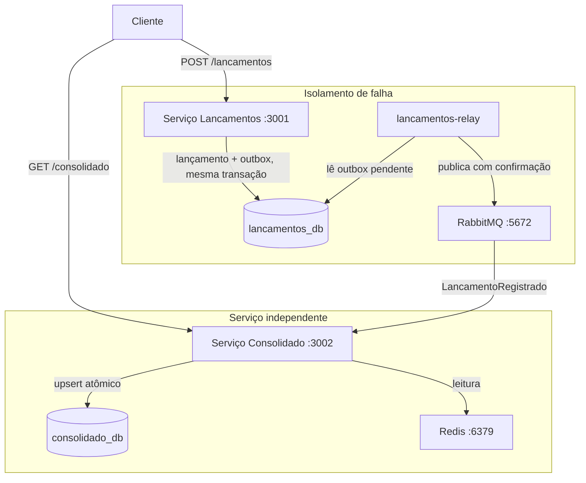

# Controle de Fluxo de Caixa

Dois microsserviços independentes: Lancamentos registra débitos e créditos;
Consolidado mantém a projeção de saldo diário por data. Eles nunca se comunicam
diretamente. Lancamentos grava o evento na mesma transação do lançamento (Outbox Pattern)
e um processo separado, o `lancamentos-relay`, o publica no RabbitMQ com confirmação do
broker; Consolidado consome e aplica um upsert atômico no próprio banco.

A consequência prática: Consolidado pode cair sem interromper o registro de lançamentos.
O evento fica enfileirado e é processado quando o serviço voltar. Idempotência garante que
reentregas não duplicam o saldo.



| Decisão | Escolha | Motivo |
|---|---|---|
| Comunicação | RabbitMQ assíncrono | Lançamentos nunca depende do Consolidado estar no ar |
| Persistência de eventos | Outbox Pattern | Evento gravado na mesma transação do lançamento, zero perda se o broker oscilar |
| Publicação | Relay separado, `ConfirmChannel` e `FOR UPDATE SKIP LOCKED` | Só marca como publicado depois do ack do broker; várias réplicas não duplicam eventos |
| Idempotência | `eventos_processados` PK no consumidor; `X-Idempotency-Key` com hash do corpo na API | Redelivery não duplica saldo; chave reutilizada com outro corpo devolve 409 |
| Concorrência no saldo | Upsert atômico (`ON CONFLICT DO UPDATE`) | Sem race condition com múltiplos consumidores |
| Valores monetários | String decimal na API, `NUMERIC(15,2)` + `decimal.js` | Float binário não representa dinheiro com precisão |
| Datas de competência | `DATE` lido como string `YYYY-MM-DD` | Sem deslocamento de dia por fuso e sem timestamp na resposta |
| Erros HTTP | `application/problem+json` (RFC 7807) | Contrato de erro uniforme; entrada inválida é sempre 400, nunca 500 |
| Cache | Redis com fallback no banco | GET /consolidado suporta 50 req/s com <5% de perda |

---

## Pré-requisitos

- Docker Desktop >= 4.x
- Node 20 ou superior, apenas para rodar os testes fora do container
- Portas livres: 3001, 3002, 5432, 5672, 6379, 15672

---

## Subindo o sistema

PowerShell:

```powershell
Copy-Item .env.example .env
docker compose up -d --build --wait
docker compose ps
```

Linux ou macOS: `cp .env.example .env` no lugar do `Copy-Item`.

O `--wait` só retorna quando todos os healthchecks passam. `docker compose ps` deve mostrar os
6 containers (`postgres`, `rabbitmq`, `redis`, `lancamentos`, `lancamentos-relay`,
`consolidado`) como `healthy`. A primeira execução compila as imagens e leva alguns minutos.

Portas: lancamentos `:3001`, consolidado `:3002`, RabbitMQ Management `:15672`.
O `lancamentos-relay` não publica porta no host, para poder ter várias réplicas
(`docker compose up -d --scale lancamentos-relay=3`).

### Dados de exemplo (opcional)

O sistema sobe vazio. Para popular com quatro lançamentos de exemplo, enviados pela API:

```powershell
.\scripts\seed-demo.ps1
```

No Linux, macOS ou Git Bash: `bash scripts/seed-demo.sh`. Os scripts podem rodar mais de uma
vez no mesmo dia, porque usam chaves de idempotência.

### Recomeçar do zero

```powershell
docker compose down -v
```

O `-v` apaga os volumes nomeados (`postgres_data`, `rabbitmq_data`, `grafana_data`).

---

## Autenticação

O endpoint `/auth/login` devolve um token JWT sem verificar credenciais e existe para
facilitar o teste local. Em produção isso seria substituído por OAuth2.

PowerShell:

```powershell
$TOKEN = (Invoke-RestMethod -Method Post http://localhost:3001/auth/login `
  -ContentType 'application/json' -Body '{}').token
$H = @{ Authorization = "Bearer $TOKEN" }
```

bash ou zsh:

```bash
TOKEN=$(curl -s -X POST http://localhost:3001/auth/login \
  -H 'Content-Type: application/json' -d '{}' | sed -n 's/.*"token":"\([^"]*\)".*/\1/p')
```

Token válido por 24h. JWT_SECRET padrão: `dev-secret-change-in-production`.

### Comerciante

O sistema é multi-comerciante. O comerciante vem do claim `comerciante_id` do token, **nunca do
corpo da requisição**: um campo com esse nome no corpo é ignorado, e token sem o claim recebe 403.
O login de desenvolvimento aceita escolher o comerciante (sem corpo, usa `padrao`):

```powershell
$TOKEN2 = (Invoke-RestMethod -Method Post http://localhost:3001/auth/login `
  -ContentType 'application/json' -Body '{"comerciante":"loja-2"}').token
$H2 = @{ Authorization = "Bearer $TOKEN2" }
```

A chave `X-Idempotency-Key` vale por comerciante. Identificadores têm de 1 a 64 caracteres entre
letras, números, hífen e sublinhado.


---

## Usando a API

Os exemplos usam PowerShell e as variáveis `$TOKEN` e `$H` da seção anterior.

### Regras do contrato

| Campo | Regra |
|---|---|
| `valor` | **String** decimal, maior que zero, até 2 casas e no máximo `999999999.99`. Número JSON (`150.5`) é recusado, porque já chegaria como float. |
| `tipo` | `credito` ou `debito` |
| `data` | Data real do calendário no formato `YYYY-MM-DD` (`2026-02-30` é recusada) |
| `descricao` | Opcional, até 500 caracteres |
| `X-Idempotency-Key` | Opcional, de 1 a 255 caracteres |

Todas as datas saem das respostas como `YYYY-MM-DD`. Erros seguem a RFC 7807
(`Content-Type: application/problem+json`): entrada inválida é `400`, chave de idempotência
reutilizada com outro corpo é `409`.

### Lançamentos

```powershell
# Registrar crédito (201)
$corpo = '{"valor":"1500.00","tipo":"credito","descricao":"Venda produto X","data":"2026-06-15"}'
Invoke-RestMethod -Method Post http://localhost:3001/lancamentos -Headers $H `
  -ContentType 'application/json' -Body $corpo

# Registrar débito
$corpo = '{"valor":"350.50","tipo":"debito","descricao":"Compra de insumos","data":"2026-06-15"}'
Invoke-RestMethod -Method Post http://localhost:3001/lancamentos -Headers $H `
  -ContentType 'application/json' -Body $corpo

# Com chave de idempotência: repetir a chamada devolve 200 com o mesmo lançamento
$H2 = $H + @{ 'X-Idempotency-Key' = 'pedido-7742' }
$corpo = '{"valor":"200.00","tipo":"credito","descricao":"Ajuste","data":"2026-06-15"}'
Invoke-RestMethod -Method Post http://localhost:3001/lancamentos -Headers $H2 `
  -ContentType 'application/json' -Body $corpo

# Mesma chave com outro corpo: 409 Conflict
Invoke-WebRequest -UseBasicParsing -Method Post http://localhost:3001/lancamentos -Headers $H2 `
  -ContentType 'application/json' `
  -Body '{"valor":"999.00","tipo":"credito","data":"2026-06-15"}'

# Listar lançamentos do dia
Invoke-RestMethod "http://localhost:3001/lancamentos?data=2026-06-15" -Headers $H
```

### Consolidado

Cada comerciante enxerga apenas os próprios números. O dia e o acumulado vêm da mesma consulta.

```powershell
Invoke-RestMethod "http://localhost:3002/consolidado/2026-06-15" -Headers $H
```

```json
{
  "source": "database",
  "comercianteId": "padrao",
  "data": "2026-06-15",
  "totalCreditos": "1700.00",
  "totalDebitos": "350.50",
  "resultadoDia": "1349.50",
  "saldoAcumulado": "5120.00",
  "ultimoEventoAplicadoEm": "2026-06-15T18:42:10.123Z"
}
```

| Campo | Significado |
|---|---|
| `resultadoDia` | Créditos menos débitos da data |
| `saldoAcumulado` | Soma do resultado de todos os dias do comerciante até a data, inclusive |
| `ultimoEventoAplicadoEm` | O maior `createdAt` entre os eventos já aplicados. Indica o atraso aproximado, **não garante completude**: com eventos fora de ordem, um lançamento mais antigo que esse instante ainda pode estar a caminho. `null` se o comerciante nunca teve lançamento |
| `source` | `cache` (Redis) ou `database` |

Dia sem movimento não é erro: responde 200 com zeros no dia e o acumulado vigente.

Intervalo, com um item por dia (inclusive vazios) e limite de 92 dias:

```powershell
Invoke-RestMethod "http://localhost:3002/consolidado?inicio=2026-06-01&fim=2026-06-30" -Headers $H
```

O cache é por comerciante, versão e data (`saldo:{comerciante}:v{versao}:{data}`, TTL de 60 s). A
versão é um contador por comerciante que o consumidor incrementa depois de aplicar cada evento:
o que estava em cache sob a versão anterior deixa de ser lido. Isso cobre o lançamento retroativo
(o acumulado das datas seguintes também muda) e fecha a corrida em que uma leitura lenta gravava
o valor antigo depois da invalidação. Decisões e trade-offs no ADR-009.

---

## Testes

### Unitários

Rodam dentro do container, sem infra externa. Todos importam o código de produção
(validação, hash de idempotência, interpretação de eventos, cálculo de delta, backoff, retry
e contrato HTTP dos erros).

```powershell
docker compose run --rm lancamentos npm test
docker compose run --rm consolidado npm test
```

### Integração, com Postgres, RabbitMQ e Redis reais

```powershell
.\test-integration.ps1
```

No Linux, macOS ou Git Bash: `bash test-integration.sh`.

Sobe a infra isolada (postgres:5433, rabbitmq:5673, redis:6380), roda os testes dos dois
serviços e derruba tudo, passando ou falhando. Precisa de Node 20 ou superior no host.

O que é coberto:

- Lançamento e evento do outbox gravados na mesma transação, e desfeitos juntos quando a gravação do outbox falha
- Idempotência, inclusive com 10 requisições simultâneas na mesma chave, e 409 para corpo diferente
- Isolamento entre comerciantes (lançamentos, idempotência, saldo e cache), com o comerciante vindo do token
- Saldo acumulado correto com lançamento retroativo, e corrida simulada entre uma leitura lenta e um evento (o valor antigo nunca é servido)
- Dia sem movimento (200 com zeros), `ultimoEventoAplicadoEm` e consulta por intervalo com limite de dias
- Upgrade das migrations sobre dados que já existiam, em banco temporário
- Relay: nada é marcado como publicado sem confirmação do broker, nem quando a mensagem volta por falta de rota
- 3 relays concorrentes publicando 200 eventos sem duplicar nem perder
- Reconexão ao RabbitMQ de verdade, derrubando as conexões no broker
- Consumidor: retry com backoff, DLQ, evento malformado direto para a DLQ, idempotência e invalidação do cache

---

## Teste de carga (k6)

Prova o requisito de 50 req/s em `GET /consolidado/{data}` com < 5% de perda.
Dois cenários em sequência: cache quente (Redis) e pior caso (Postgres, 60 datas distintas).
Exit code 0 = todos os thresholds passaram.

```powershell
docker compose --profile loadtest run --rm k6
```

Detalhes, thresholds e saída esperada em `tests/load/README.md`.

---

## Isolamento de falha, verificação manual

```powershell
# Derruba o Consolidado
docker compose stop consolidado

# Lançamentos continua respondendo 201
$corpo = '{"valor":"999.00","tipo":"credito","descricao":"Teste de isolamento","data":"2026-06-20"}'
Invoke-RestMethod -Method Post http://localhost:3001/lancamentos -Headers $H `
  -ContentType 'application/json' -Body $corpo

# Sobe o Consolidado; ele drena a fila sozinho
docker compose up -d --wait consolidado
Start-Sleep -Seconds 5

# O saldo aparece (consistência eventual)
Invoke-RestMethod "http://localhost:3002/consolidado/2026-06-20" -Headers $H
```

O lançamento foi gravado no banco e no outbox na mesma transação, e o relay publicou no broker
com confirmação. Quando o Consolidado voltou, consumiu o evento e aplicou o upsert. Nenhum
evento perdido, nenhum duplicado.

### Derrubando o RabbitMQ

```powershell
docker compose stop rabbitmq
# A API de lançamentos continua em /ready = 200 e aceitando lançamentos.
# O consolidado e o lancamentos-relay ficam em /ready = 503.
(Invoke-WebRequest -UseBasicParsing http://localhost:3001/ready).StatusCode
$corpo = '{"valor":"10.00","tipo":"credito","data":"2026-06-21"}'
Invoke-RestMethod -Method Post http://localhost:3001/lancamentos -Headers $H `
  -ContentType 'application/json' -Body $corpo

docker compose start rabbitmq
# Os dois serviços reconectam sozinhos e o evento pendente é publicado.
```

O lançamento fica pendente no outbox enquanto o broker está fora e é publicado quando ele volta.

---

## Observabilidade (profile opcional)

```bash
docker compose --profile observability up -d
# Grafana:    http://localhost:3000  (admin/admin)
# Prometheus: http://localhost:9090
# RabbitMQ:   http://localhost:15672 (rabbit/rabbit)
```

---

## Documentação

- `docs/arquitetura.md` — C4 Context/Container/Component com diagramas Mermaid
- `docs/adrs/`: 9 ADRs cobrindo as decisões de projeto
- `docs/eventos.md`: contrato do evento e política de versionamento
- `docs/requisitos.md` — requisitos funcionais e não-funcionais
- `docs/seguranca.md` — autenticação, rate limiting, modelo de segurança para produção
- `docs/arquitetura-alvo-cloud.md` — deploy na AWS (ECS, RDS, MQ, ElastiCache)
- `docs/custos.md` — estimativa de custo mensal
- `tests/load/README.md` — detalhes do teste de carga k6

---

## Diferenças em relação a um ambiente de produção

Simplificações conscientes, não esquecimentos.

| Aspecto | Neste desafio | Em produção |
|---|---|---|
| Instâncias de banco | `lancamentos_db` e `consolidado_db` no mesmo Postgres | Instâncias separadas (RDS separados), um banco sobrecarregado não degrada o outro |
| RabbitMQ | Single-node | Cluster de 3 nós com quorum queues, sem clustering, morte do broker antes do ack é perda permanente |
| Publisher confirms | Implementado: o relay usa `ConfirmChannel`, `mandatory` e só marca publicado após o ack | Igual, com quorum queues para que o ack signifique replicação em maioria |
| Redis | Standalone | Redis Sentinel ou ElastiCache Multi-AZ, failover automático elimina o pico de miss após reinício |
| Outbox relay | Processo próprio (`lancamentos-relay`), consulta a cada 1s com `FOR UPDATE SKIP LOCKED`; escala por réplicas | CDC via Debezium lendo o WAL, sem SELECT periódico ao banco, se a latência de 1s não bastar |
| Migrações | Rodam no startup do serviço | Passo separado no pipeline de CI/CD antes de qualquer instância nova subir e evita colisão entre pods |
| Autenticação | JWT com secret em `.env`, endpoint `/auth/login` sem credenciais | OAuth2/OIDC (Cognito, Keycloak) com tokens de curta duração, o endpoint sem credenciais é uma vulnerabilidade em produção |
| TLS | HTTP puro | TLS em endpoints públicos; mTLS ou service mesh na comunicação interna |
| Logs | `pino` para stdout | Coleta com Fluentd/Firehose para CloudWatch Logs com retenção e alertas |
