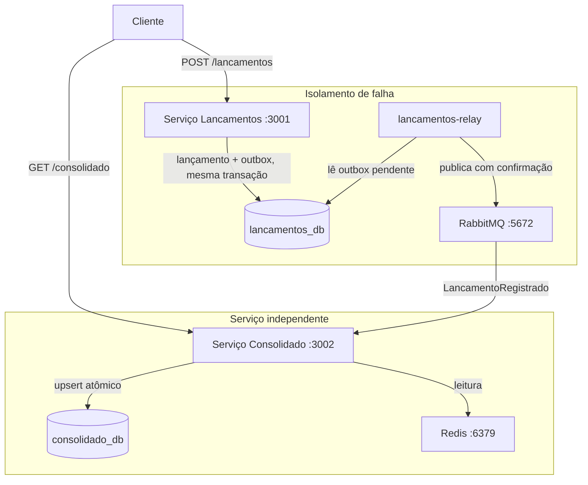

# Controle de Fluxo de Caixa

Dois microsserviços independentes: Lancamentos registra débitos e créditos;
Consolidado mantém a projeção de saldo diário por data. Eles nunca se comunicam
diretamente. Lancamentos grava o evento na mesma transação do lançamento (Outbox Pattern)
e um processo separado, o `lancamentos-relay`, o publica no RabbitMQ com confirmação do
broker; Consolidado consome e aplica um upsert atômico no próprio banco.

A consequência prática: Consolidado pode cair sem interromper o registro de lançamentos.
O evento fica enfileirado e é processado quando o serviço voltar. Idempotência garante que
reentregas não duplicam o saldo.



| Decisão | Escolha | Motivo |
|---|---|---|
| Comunicação | RabbitMQ assíncrono | Lançamentos nunca depende do Consolidado estar no ar |
| Persistência de eventos | Outbox Pattern | Evento gravado na mesma transação do lançamento, zero perda se o broker oscilar |
| Publicação | Relay separado, `ConfirmChannel` e `FOR UPDATE SKIP LOCKED` | Só marca como publicado depois do ack do broker; várias réplicas não duplicam eventos |
| Idempotência | `eventos_processados` PK no consumidor; `X-Idempotency-Key` com hash do corpo na API | Redelivery não duplica saldo; chave reutilizada com outro corpo devolve 409 |
| Concorrência no saldo | Upsert atômico (`ON CONFLICT DO UPDATE`) | Sem race condition com múltiplos consumidores |
| Valores monetários | String decimal na API, `NUMERIC(15,2)` + `decimal.js` | Float binário não representa dinheiro com precisão |
| Datas de competência | `DATE` lido como string `YYYY-MM-DD` | Sem deslocamento de dia por fuso e sem timestamp na resposta |
| Erros HTTP | `application/problem+json` (RFC 7807) | Contrato de erro uniforme; entrada inválida é sempre 400, nunca 500 |
| Cache | Redis com fallback no banco | GET /consolidado suporta 50 req/s com <5% de perda |

---

## Pré-requisitos

- Docker Desktop >= 4.x
- Node 20 ou superior, apenas para rodar os testes fora do container
- Portas livres: 3001, 3002, 5432, 5672, 6379, 8080, 15672

---

## Subindo o sistema

PowerShell:

```powershell
Copy-Item .env.example .env
docker compose up -d --build --wait
docker compose ps
```

Linux ou macOS: `cp .env.example .env` no lugar do `Copy-Item`.

O `--wait` só retorna quando todos os healthchecks passam. `docker compose ps` deve mostrar os
7 containers (`postgres`, `rabbitmq`, `redis`, `keycloak`, `lancamentos`, `lancamentos-relay`,
`consolidado`) como `healthy`. A primeira execução compila as imagens e leva alguns minutos.

Portas: lancamentos `:3001`, consolidado `:3002`, Keycloak `:8080`, RabbitMQ Management `:15672`.
O `lancamentos-relay` não publica porta no host, para poder ter várias réplicas
(`docker compose up -d --scale lancamentos-relay=3`).

### Dados de exemplo (opcional)

O sistema sobe vazio. Para popular com quatro lançamentos de exemplo, enviados pela API:

```powershell
.\scripts\seed-demo.ps1
```

No Linux, macOS ou Git Bash: `bash scripts/seed-demo.sh`. Os scripts podem rodar mais de uma
vez no mesmo dia, porque usam chaves de idempotência.

### Recomeçar do zero

```powershell
docker compose down -v
```

O `-v` apaga os volumes nomeados (`postgres_data`, `rabbitmq_data`, `grafana_data`).

---

## Autenticação e autorização

As APIs só aceitam **tokens JWT emitidos pelo Keycloak** (OAuth2, fluxo *client credentials*). Não existe
mais login de desenvolvimento nem segredo compartilhado: os serviços validam a assinatura (RS256) com a
chave pública do Keycloak, além de issuer, audiência e expiração. Console do Keycloak:
http://localhost:8080 (usuário `admin`, senha `admin`, somente desenvolvimento).

Cada integrador é um cliente do realm `caixa`. O **comerciante e os escopos são amarrados ao cliente**
pelo administrador do realm; quem pede o token não escolhe em nome de quem age, e o corpo da
requisição nunca define o comerciante.

| Cliente | Comerciante | Pode |
|---|---|---|
| `erp-loja-1` | loja-1 | registrar e listar lançamentos, consultar o consolidado |
| `erp-loja-2` | loja-2 | o mesmo, para a loja-2 (prova o isolamento) |
| `bi-loja-1` | loja-1 | somente consultar o consolidado |
| `contabil-loja-1` | loja-1 | listar lançamentos e consultar o consolidado, sem gravar |

Obtendo um token (PowerShell). O script chama o Keycloak com o segredo de desenvolvimento do cliente:

```powershell
$TOKEN = .\scripts\obter-token.ps1 -Cliente erp-loja-1
$H = @{ Authorization = "Bearer $TOKEN" }
```

bash, zsh ou Git Bash: `TOKEN=$(bash scripts/obter-token.sh erp-loja-1)`.

O token vale 300 s; depois disso peça outro. Sem token ou com token inválido a resposta é 401, e com
token válido mas sem o escopo da rota é 403 (`WWW-Authenticate: ... insufficient_scope`):

```powershell
# A contabilidade lê, mas não grava: 403
$HC = @{ Authorization = "Bearer $(.\scripts\obter-token.ps1 -Cliente contabil-loja-1)" }
Invoke-WebRequest -UseBasicParsing -Method Post http://localhost:3001/lancamentos -Headers $HC `
  -ContentType 'application/json' -Body '{"valor":"1.00","tipo":"credito","data":"2026-06-15"}'
```

Se o Keycloak ficar fora do ar, quem já tem token continua sendo atendido (as chaves ficam em cache nos
serviços); um serviço que acabou de subir e nunca viu as chaves responde 503 com `Retry-After`.
Detalhes, critérios de onboarding de consumidores e limitações em [docs/seguranca.md](docs/seguranca.md) e
no [ADR-010](docs/adrs/ADR-010-autenticacao-e-autorizacao-de-consumo.md).

A chave `X-Idempotency-Key` vale por comerciante. Identificadores de comerciante têm de 1 a 64 caracteres
entre letras, números, hífen e sublinhado.

---

## Usando a API

Os exemplos usam PowerShell e as variáveis `$TOKEN` e `$H` da seção anterior (token do `erp-loja-1`).

### Regras do contrato

| Campo | Regra |
|---|---|
| `valor` | **String** decimal, maior que zero, até 2 casas e no máximo `999999999.99`. Número JSON (`150.5`) é recusado, porque já chegaria como float. |
| `tipo` | `credito` ou `debito` |
| `data` | Data real do calendário no formato `YYYY-MM-DD` (`2026-02-30` é recusada) |
| `descricao` | Opcional, até 500 caracteres |
| `X-Idempotency-Key` | Opcional, de 1 a 255 caracteres |

Todas as datas saem das respostas como `YYYY-MM-DD`. Erros seguem a RFC 7807
(`Content-Type: application/problem+json`): entrada inválida é `400`, chave de idempotência
reutilizada com outro corpo é `409`.

### Lançamentos

```powershell
# Registrar crédito (201)
$corpo = '{"valor":"1500.00","tipo":"credito","descricao":"Venda produto X","data":"2026-06-15"}'
Invoke-RestMethod -Method Post http://localhost:3001/lancamentos -Headers $H `
  -ContentType 'application/json' -Body $corpo

# Registrar débito
$corpo = '{"valor":"350.50","tipo":"debito","descricao":"Compra de insumos","data":"2026-06-15"}'
Invoke-RestMethod -Method Post http://localhost:3001/lancamentos -Headers $H `
  -ContentType 'application/json' -Body $corpo

# Com chave de idempotência: repetir a chamada devolve 200 com o mesmo lançamento
$H2 = $H + @{ 'X-Idempotency-Key' = 'pedido-7742' }
$corpo = '{"valor":"200.00","tipo":"credito","descricao":"Ajuste","data":"2026-06-15"}'
Invoke-RestMethod -Method Post http://localhost:3001/lancamentos -Headers $H2 `
  -ContentType 'application/json' -Body $corpo

# Mesma chave com outro corpo: 409 Conflict
Invoke-WebRequest -UseBasicParsing -Method Post http://localhost:3001/lancamentos -Headers $H2 `
  -ContentType 'application/json' `
  -Body '{"valor":"999.00","tipo":"credito","data":"2026-06-15"}'

# Listar lançamentos do dia
Invoke-RestMethod "http://localhost:3001/lancamentos?data=2026-06-15" -Headers $H
```

### Consolidado

Cada comerciante enxerga apenas os próprios números. O dia e o acumulado vêm da mesma consulta.

```powershell
Invoke-RestMethod "http://localhost:3002/consolidado/2026-06-15" -Headers $H
```

```json
{
  "source": "database",
  "comercianteId": "padrao",
  "data": "2026-06-15",
  "totalCreditos": "1700.00",
  "totalDebitos": "350.50",
  "resultadoDia": "1349.50",
  "saldoAcumulado": "5120.00",
  "ultimoEventoAplicadoEm": "2026-06-15T18:42:10.123Z"
}
```

| Campo | Significado |
|---|---|
| `resultadoDia` | Créditos menos débitos da data |
| `saldoAcumulado` | Soma do resultado de todos os dias do comerciante até a data, inclusive |
| `ultimoEventoAplicadoEm` | O maior `createdAt` entre os eventos já aplicados. Indica o atraso aproximado, **não garante completude**: com eventos fora de ordem, um lançamento mais antigo que esse instante ainda pode estar a caminho. `null` se o comerciante nunca teve lançamento |
| `source` | `cache` (Redis) ou `database` |

Dia sem movimento não é erro: responde 200 com zeros no dia e o acumulado vigente.

Intervalo, com um item por dia (inclusive vazios) e limite de 92 dias:

```powershell
Invoke-RestMethod "http://localhost:3002/consolidado?inicio=2026-06-01&fim=2026-06-30" -Headers $H
```

O cache é por comerciante, versão e data (`saldo:{comerciante}:v{versao}:{data}`, TTL de 60 s). A
versão é um contador por comerciante que o consumidor incrementa depois de aplicar cada evento:
o que estava em cache sob a versão anterior deixa de ser lido. Isso cobre o lançamento retroativo
(o acumulado das datas seguintes também muda) e fecha a corrida em que uma leitura lenta gravava
o valor antigo depois da invalidação. Decisões e trade-offs no ADR-009.

---

## Testes

### Unitários

Rodam dentro do container, sem infra externa. Todos importam o código de produção
(validação, hash de idempotência, interpretação de eventos, cálculo de delta, backoff, retry,
contrato HTTP dos erros, segurança do JWT, métricas HTTP e propagação de trace).
O lint roda com `npm run lint` dentro de cada serviço, e o CI executa lint, tipos, testes e build das imagens.
A estratégia completa, ligada aos requisitos não funcionais, está em [docs/testes.md](docs/testes.md).

```powershell
docker compose run --rm lancamentos npm test
docker compose run --rm consolidado npm test
```

### Integração, com Postgres, RabbitMQ e Redis reais

```powershell
.\test-integration.ps1
```

No Linux, macOS ou Git Bash: `bash test-integration.sh`.

Sobe a infra isolada (postgres:5433, rabbitmq:5673, redis:6380), roda os testes dos dois
serviços e derruba tudo, passando ou falhando. Precisa de Node 20 ou superior no host.

O que é coberto:

- Lançamento e evento do outbox gravados na mesma transação, e desfeitos juntos quando a gravação do outbox falha
- Idempotência, inclusive com 10 requisições simultâneas na mesma chave, e 409 para corpo diferente
- Isolamento entre comerciantes (lançamentos, idempotência, saldo e cache), com o comerciante vindo do token
- Segurança de consumo: token vencido, assinado por outra chave, de outro issuer ou de outra audiência, HS256 e `alg: none`, escopo insuficiente, Keycloak fora do ar e rotação de chaves
- Saldo acumulado correto com lançamento retroativo, e corrida simulada entre uma leitura lenta e um evento (o valor antigo nunca é servido)
- Dia sem movimento (200 com zeros), `ultimoEventoAplicadoEm` e consulta por intervalo com limite de dias
- Upgrade das migrations sobre dados que já existiam, em banco temporário
- Relay: nada é marcado como publicado sem confirmação do broker, nem quando a mensagem volta por falta de rota
- 3 relays concorrentes publicando 200 eventos sem duplicar nem perder
- Reconexão ao RabbitMQ de verdade, derrubando as conexões no broker
- Consumidor: retry com backoff, DLQ, evento malformado direto para a DLQ, idempotência e invalidação do cache
- O `traceparent` da requisição é gravado no outbox e sai no cabeçalho da mensagem publicada

### Resiliência, com a stack inteira no ar

```powershell
docker compose up -d --build --wait
.\tests\resiliencia\resiliencia.ps1
```

No Linux, macOS ou Git Bash: `bash tests/resiliencia/resiliencia.sh`.

Cria 30 lançamentos com o consolidado parado e exige 201 em todos, sobe o consolidado e espera o saldo convergir. Repete derrubando o RabbitMQ: os lançamentos seguem aceitos, o outbox acumula e, na volta do broker, drena. Sai com código diferente de zero se qualquer verificação falhar e salva a saída em `docs/evidencias/`.

---

## Teste de carga (k6)

Prova o requisito de 50 req/s em `GET /consolidado/{data}` com menos de 5% de perda, em dois cenários
em sequência (cache quente e pior caso com 60 datas distintas), e acrescenta um pico de 200 req/s
acima da cota do limitador, em que só podem aparecer 200 e 429, todo 429 com `Retry-After` e nenhum 5xx.
O código de saída 0 significa que todos os limites passaram.

```powershell
docker compose --profile loadtest run --rm k6
```

Para provar o 429 de forma determinística, baixe o limite do consolidado para 300 por minuto (variável `RATE_LIMIT_MAX`), envie uma rajada e volte ao limite de produção:

```powershell
.\tests\load\limite-429.ps1
```

No Git Bash: `bash tests/load/limite-429.sh`.

Outros cenários: histórico de 3 anos de um comerciante (`tests/load/historico-longo.js`) e comparação
entre configurações (`tests/load/ablacao.js`). Resultados reais, incluindo uma execução que falhou
os limites de latência antes da correção da degradação encontrada, a capacidade observada e os picos isolados de latência que ficaram sem causa identificada:
`tests/load/README.md` e `docs/evidencias/`.

---

## Isolamento de falha, verificação manual

```powershell
# Derruba o Consolidado
docker compose stop consolidado

# Lançamentos continua respondendo 201
$corpo = '{"valor":"999.00","tipo":"credito","descricao":"Teste de isolamento","data":"2026-06-20"}'
Invoke-RestMethod -Method Post http://localhost:3001/lancamentos -Headers $H `
  -ContentType 'application/json' -Body $corpo

# Sobe o Consolidado; ele drena a fila sozinho
docker compose up -d --wait consolidado
Start-Sleep -Seconds 5

# O saldo aparece (consistência eventual)
Invoke-RestMethod "http://localhost:3002/consolidado/2026-06-20" -Headers $H
```

O lançamento foi gravado no banco e no outbox na mesma transação, e o relay publicou no broker
com confirmação. Quando o Consolidado voltou, consumiu o evento e aplicou o upsert. Nenhum
evento perdido, nenhum duplicado.

### Derrubando o RabbitMQ

```powershell
docker compose stop rabbitmq
# A API de lançamentos continua em /ready = 200 e aceitando lançamentos.
# O consolidado e o lancamentos-relay ficam em /ready = 503.
(Invoke-WebRequest -UseBasicParsing http://localhost:3001/ready).StatusCode
$corpo = '{"valor":"10.00","tipo":"credito","data":"2026-06-21"}'
Invoke-RestMethod -Method Post http://localhost:3001/lancamentos -Headers $H `
  -ContentType 'application/json' -Body $corpo

docker compose start rabbitmq
# Os dois serviços reconectam sozinhos e o evento pendente é publicado.
```

O lançamento fica pendente no outbox enquanto o broker está fora e é publicado quando ele volta.

---

## Observabilidade (profile opcional)

```powershell
# Métricas e dashboards
docker compose --profile observability up -d --wait
# Métricas, dashboards e traces (liga o tracing nos três processos)
docker compose -f docker-compose.yml -f docker-compose.tracing.yml --profile observability up -d --wait
# Grafana:    http://localhost:3000  (admin/admin), dashboard "Fluxo de Caixa: Overview"
# Prometheus: http://localhost:9090
# Jaeger:     http://localhost:16686 (traces)
# RabbitMQ:   http://localhost:15672 (rabbit/rabbit)
```

Para ver um trace, registre um lançamento (`.\scripts\seed-demo.ps1`) e procure o serviço `lancamentos` no Jaeger:
o mesmo trace atravessa a API, o relay e o consolidado. Os logs trazem `traceId`.
Para conferir no Prometheus que cada painel do dashboard tem dado: `.\scripts\verificar-dashboard.ps1`.

O tracing vem desligado por padrão porque acrescenta CPU por requisição (`docs/observabilidade.md` e `docs/evidencias/regressao-latencia.txt`). Só o segundo comando acima o liga.

---

## Documentação

- `docs/arquitetura.md`: C4 (contexto, containers e componentes) em Mermaid e tabela de cenários de falha
- `docs/adrs/`: 10 ADRs cobrindo as decisões de projeto
- `docs/eventos.md`: contrato do evento e política de versionamento
- `docs/requisitos.md`: requisitos funcionais e não funcionais
- `docs/testes.md`: pirâmide de testes ligada aos requisitos não funcionais
- `docs/observabilidade.md`: métricas, logs, tracing e SLOs
- `docs/evidencias/`: saídas reais de resiliência, k6, trace, dashboard e custos medidos
- `docs/seguranca.md`: modelo de consumo (OAuth2 e escopos), resiliência da autenticação, limitações e produção
- `keycloak/realm-caixa.json`: realm de desenvolvimento com os clientes de integração
- `docs/arquitetura-alvo-cloud.md`: arquitetura alvo na AWS (ECS, RDS, Amazon MQ, ElastiCache)
- `docs/custos.md`: estimativa de custos em sa-east-1, dois cenários, com memória de cálculo e licenças
- `docs/dimensionamento.md`: capacidade medida, hipóteses e como validar na AWS
- `docs/disaster-recovery.md`: RTO e RPO, backup e roteiro de operação
- `docs/evolucoes.md`: evoluções priorizadas, cada uma com seu gatilho
- `docs/arquitetura-transicao.md`: migração do legado (Strangler Fig)
- `docs/dominios-e-capacidades.md`: domínios, capacidades de negócio e contexto delimitado
- `tests/load/README.md`: detalhes dos testes de carga k6

---

## Diferenças em relação a um ambiente de produção

Simplificações conscientes, não esquecimentos.

| Aspecto | Neste desafio | Em produção |
|---|---|---|
| Instâncias de banco | `lancamentos_db` e `consolidado_db` no mesmo Postgres | Instâncias separadas (RDS separados), um banco sobrecarregado não degrada o outro |
| RabbitMQ | Single-node: sem replicação, e a morte do broker antes do consumo perde as mensagens não consumidas (o outbox preserva o evento no banco) | Cluster de 3 nós com quorum queues (Amazon MQ), em 3 AZs |
| Publisher confirms | Implementado: o relay usa `ConfirmChannel`, `mandatory` e só marca publicado após o ack | Igual, com quorum queues para que o ack signifique replicação em maioria |
| Redis | Standalone | Redis Sentinel ou ElastiCache Multi-AZ, failover automático elimina o pico de miss após reinício |
| Outbox relay | Processo próprio (`lancamentos-relay`), consulta a cada 1s com `FOR UPDATE SKIP LOCKED`; escala por réplicas | CDC via Debezium lendo o WAL, sem SELECT periódico ao banco, se a latência de 1s não bastar |
| Migrações | Rodam no startup do serviço | Passo separado no pipeline de CI/CD antes de qualquer instância nova subir e evita colisão entre pods |
| Identidade | Keycloak em modo desenvolvimento (banco embutido, HTTP), segredos de cliente no `realm-caixa.json` | Keycloak em modo produção com PostgreSQL e TLS, ou Cognito; segredos no Secrets Manager com rotação; `private_key_jwt` ou mTLS para integradores sensíveis |
| TLS | HTTP puro | TLS em endpoints públicos; mTLS ou service mesh na comunicação interna |
| Logs | `pino` para stdout | Coleta com Fluentd/Firehose para CloudWatch Logs com retenção e alertas |
