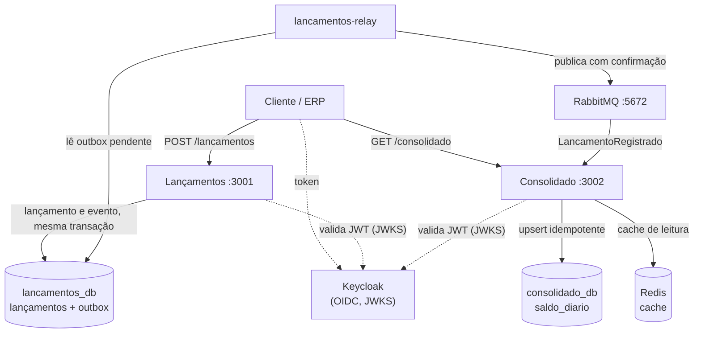

# Controle de Fluxo de Caixa

Um comerciante registra débitos e créditos ao longo do dia e precisa do **saldo diário consolidado**. A solução tem dois microsserviços que nunca se chamam diretamente: **Lançamentos** grava o lançamento e o evento na mesma transação (Outbox), um processo separado (`lancamentos-relay`) publica o evento no broker (RabbitMQ no ambiente local) com confirmação, e **Consolidado** consome o evento, aplica um upsert idempotente no próprio banco e serve o saldo com cache no Redis. Se o Consolidado cair, os lançamentos continuam sendo aceitos e o saldo converge quando ele volta.



## Como os requisitos não funcionais foram atendidos

| Requisito | Como | Evidência |
|---|---|---|
| **Lançamentos não pode ficar indisponível se o Consolidado cair** | Processos, bancos e filas separados; comunicação só assíncrona (Outbox + RabbitMQ). A API de lançamentos depende apenas do próprio banco | Resiliência: 30 de 30 lançamentos aceitos (201) com o consolidado parado, com o RabbitMQ parado e com o banco do consolidado fora por 30 s; o saldo converge na volta ([saída](docs/evidencias/resiliencia-ps1-20261105-193611.txt), [análise](docs/testes.md)) |
| **Consolidado recebe 50 req/s com no máximo 5% de perda** | Cache Redis com fallback no PostgreSQL; instância sem estado, que escala horizontalmente | k6 a 50 req/s: 0,00% de respostas diferentes de 200 e p95 de 75,3 ms (cache quente) e 37,3 ms (cache frio); a instância respondeu cerca de 197 a 199 req/s no pico, folga de pelo menos 3,9 vezes ([saída](docs/evidencias/k6-consolidado-saida-fase6-pre.txt), [resumo](docs/evidencias/k6-consolidado-resumo.json), [capacidade e ressalvas](docs/testes.md)) |
| **Consistência eventual em segundos** | Relay a cada 1 s sem pausa com lote cheio; cache versionado por comerciante e por época | Saldo convergiu em até 4,2 s depois da volta do componente parado (resiliência, três execuções); métrica `consolidado_evento_lag_seconds` |
| **Nenhum lançamento perdido** | Outbox transacional, `ConfirmChannel` com `mandatory`, `FOR UPDATE SKIP LOCKED`, consumidor idempotente | Testes de integração do relay e do consumidor; [ADR-005](docs/adrs/ADR-005-outbox-pattern.md) |

Os números de carga são de uma máquina de desenvolvimento com todos os serviços no mesmo hardware. Servem para comparar cenários e provar o requisito, e não como capacidade de produção.

## Pré-requisitos

- Docker Desktop 4.x ou superior, com o Docker Compose v2
- Node.js 20 ou superior, apenas para a integração (`test-integration`) e para os scripts de DLQ e de dashboard
- Portas livres: 3001, 3002, 5432, 5672, 6379, 8080, 15672 (e 3000, 9090, 16686 se usar a observabilidade)

## Como subir

PowerShell:

```powershell
Copy-Item .env.example .env
docker compose up -d --build --wait
docker compose ps
```

bash, zsh ou Git Bash: `cp .env.example .env` no lugar do `Copy-Item`; os demais comandos são iguais.

`--wait` só retorna quando todos os healthchecks passam. `docker compose ps` deve mostrar `postgres`, `rabbitmq`, `redis`, `keycloak`, `lancamentos`, `lancamentos-relay` e `consolidado` como `healthy`. A primeira execução compila as imagens e o Keycloak demora mais; conte alguns minutos.

Dados de exemplo (opcional, o sistema sobe vazio): `.\scripts\seed-demo.ps1` ou `bash scripts/seed-demo.sh`. Para recomeçar do zero: `docker compose down -v`.

## Obter um token e chamar a API

As APIs só aceitam tokens JWT do Keycloak (OAuth2, *client credentials*). O comerciante e os escopos são amarrados ao cliente pelo administrador do realm; o corpo da requisição nunca define o comerciante.

| Cliente | Comerciante | Pode |
|---|---|---|
| `erp-loja-1` | loja-1 | registrar e listar lançamentos, consultar o consolidado |
| `erp-loja-2` | loja-2 | o mesmo, para a loja-2 (prova o isolamento) |
| `bi-loja-1` | loja-1 | somente consultar o consolidado |
| `contabil-loja-1` | loja-1 | listar lançamentos e consultar o consolidado, sem gravar |

PowerShell:

```powershell
$TOKEN = .\scripts\obter-token.ps1 -Cliente erp-loja-1
$H = @{ Authorization = "Bearer $TOKEN" }

# Registrar um crédito (201)
$corpo = '{"valor":"1500.00","tipo":"credito","descricao":"Venda produto X","data":"2026-06-15"}'
Invoke-RestMethod -Method Post http://localhost:3001/lancamentos -Headers $H -ContentType 'application/json' -Body $corpo

# Registrar um débito
$corpo = '{"valor":"350.50","tipo":"debito","descricao":"Compra de insumos","data":"2026-06-15"}'
Invoke-RestMethod -Method Post http://localhost:3001/lancamentos -Headers $H -ContentType 'application/json' -Body $corpo

# Consultar o saldo do dia (alguns segundos depois do registro) e um intervalo
Invoke-RestMethod "http://localhost:3002/consolidado/2026-06-15" -Headers $H
Invoke-RestMethod "http://localhost:3002/consolidado?inicio=2026-06-01&fim=2026-06-30" -Headers $H

# Listar lançamentos do dia, mais recentes primeiro (limite de 1 a 100, padrão 50)
$pagina = Invoke-RestMethod "http://localhost:3001/lancamentos?data=2026-06-15&limite=50" -Headers $H
$pagina.itens
if ($pagina.proximoCursor) { Invoke-RestMethod "http://localhost:3001/lancamentos?data=2026-06-15&cursor=$($pagina.proximoCursor)" -Headers $H }
```

bash:

```bash
TOKEN=$(bash scripts/obter-token.sh erp-loja-1)
curl -s -X POST http://localhost:3001/lancamentos -H "Authorization: Bearer $TOKEN" -H 'Content-Type: application/json' \
  -d '{"valor":"1500.00","tipo":"credito","descricao":"Venda produto X","data":"2026-06-15"}'
curl -s http://localhost:3002/consolidado/2026-06-15 -H "Authorization: Bearer $TOKEN"
```

Resposta do consolidado (`resultadoDia` é créditos menos débitos; `saldoAcumulado` soma todos os dias do comerciante até a data; `ultimoEventoAplicadoEm` indica o atraso, não garante completude):

```json
{
  "source": "database",
  "comercianteId": "loja-1",
  "data": "2026-06-15",
  "totalCreditos": "1500.00",
  "totalDebitos": "350.50",
  "resultadoDia": "1149.50",
  "saldoAcumulado": "1149.50",
  "ultimoEventoAplicadoEm": "2026-06-15T18:42:10.123Z"
}
```

Regras do contrato (a especificação completa está em `services/*/openapi.yaml`):

- `valor` é **string** decimal maior que zero, com até 2 casas e no máximo `999999999.99`. Número JSON é recusado, porque já chegaria como float.
- `tipo` é `credito` ou `debito`. `data` é uma data real `YYYY-MM-DD`. `descricao` é opcional, até 500 caracteres.
- `X-Idempotency-Key` (opcional, 1 a 255 caracteres, vale por comerciante): repetir a chamada devolve 200 com o mesmo lançamento; a mesma chave com outro corpo devolve 409.
- Erros seguem a RFC 7807 (`application/problem+json`). Entrada inválida é 400, sem token é 401, sem o escopo é 403. Dia sem movimento no consolidado é 200 com zeros.
- O token vale 300 s. Console do Keycloak em http://localhost:8080 (`admin`/`admin`, somente desenvolvimento).

## Como rodar os testes

| Tipo | PowerShell | bash | Tempo típico |
|---|---|---|---|
| Unitários | `docker compose --profile test run --rm lancamentos-test` e `... consolidado-test` | igual | cerca de 20 s por serviço |
| Integração (Postgres, RabbitMQ e Redis reais, em portas isoladas) | `.\test-integration.ps1` | `bash test-integration.sh` | cerca de 3 min |
| Resiliência (stack inteira no ar, cinco cenários) | `.\tests\resiliencia\resiliencia.ps1` | `bash tests/resiliencia/resiliencia.sh` | cerca de 8 min |
| Carga k6 (50 req/s e pico de 200 req/s) | `docker compose --profile loadtest run --rm k6` | igual | cerca de 3 min |
| Prova determinística do 429 | `.\tests\load\limite-429.ps1` | `bash tests/load/limite-429.sh` | cerca de 1 min |

Os testes de resiliência e de carga exigem a stack principal no ar (`docker compose up -d --build --wait`). A resiliência derruba, em ordem, o consolidado, o RabbitMQ, o Redis e o banco do consolidado, confere que os lançamentos seguem sendo aceitos e que o saldo converge, e reprocessa a DLQ. Sai com código diferente de zero se qualquer verificação falhar e salva a saída em `docs/evidencias/`. O k6 sai com 0 quando todos os limites passam. A estratégia completa, ligada a cada requisito, está em [docs/testes.md](docs/testes.md).

Lint e tipos: `npm run lint` e `npx tsc --noEmit` dentro de cada serviço. O CI (`.github/workflows/ci.yml`) roda lint, tipos, testes unitários e de integração e o build das imagens.

**Reprocessar a DLQ.** A fila `consolidado.lancamentos.dlq` recebe só mensagem inválida ou com erro permanente; uma queda do banco não a enche ([ADR-011](docs/adrs/ADR-011-falha-transitoria-nao-vai-para-dlq.md)). Depois de corrigir a causa: `.\scripts\reprocessar-dlq.ps1 -Simular` mostra o que seria devolvido, e `.\scripts\reprocessar-dlq.ps1` devolve (bash: `bash scripts/reprocessar-dlq.sh [--simular]`).

**Verificar o isolamento de falha à mão:**

```powershell
docker compose stop consolidado
$corpo = '{"valor":"999.00","tipo":"credito","descricao":"Teste de isolamento","data":"2026-06-20"}'
Invoke-RestMethod -Method Post http://localhost:3001/lancamentos -Headers $H -ContentType 'application/json' -Body $corpo   # 201
docker compose up -d --wait consolidado
Start-Sleep -Seconds 5
Invoke-RestMethod "http://localhost:3002/consolidado/2026-06-20" -Headers $H    # o saldo apareceu
```

## Observabilidade

```powershell
# Métricas, dashboards e alertas
docker compose --profile observability up -d --wait
# Mais traces (liga o tracing nos três processos)
docker compose -f docker-compose.yml -f docker-compose.tracing.yml --profile observability up -d --wait
```

| Ferramenta | Endereço | Observação |
|---|---|---|
| Grafana | http://localhost:3000 (`admin`/`admin`) | dashboard "Fluxo de Caixa: Overview" |
| Prometheus | http://localhost:9090 | alertas em `/alerts` (regras em `observability/alerts.yml`) |
| Jaeger | http://localhost:16686 | só com o arquivo `docker-compose.tracing.yml`; procure o serviço `lancamentos` |
| RabbitMQ | http://localhost:15672 (`rabbit`/`rabbit`) | filas, DLQ e conexões |

O tracing vem desligado por padrão porque acrescenta CPU por requisição ([docs/observabilidade.md](docs/observabilidade.md)). Para ver um trace, registre um lançamento (`.\scripts\seed-demo.ps1`): o mesmo trace atravessa a API, o relay e o consolidado, e os logs trazem `traceId`. `.\scripts\verificar-dashboard.ps1` confere no Prometheus que cada painel tem dado. Rode depois de gerar tráfego novo (alguns lançamentos e consultas pela API, ou o k6) e de esperar cerca de 40 s: os painéis de taxa ficam vazios sem tráfego recente, e o `seed-demo` repetido não gera eventos novos porque reaproveita as chaves de idempotência.

## Decisões de arquitetura

| Decisão | Escolha | ADR |
|---|---|---|
| Estilo de arquitetura | Dois microsserviços em vez de monólito | [ADR-001](docs/adrs/ADR-001-microsservicos-vs-monolito.md) |
| Comunicação | Assíncrona por eventos | [ADR-002](docs/adrs/ADR-002-comunicacao-assincrona.md) |
| Broker | RabbitMQ em vez de Kafka ou Pub/Sub no ambiente local | [ADR-003](docs/adrs/ADR-003-rabbitmq-vs-kafka-vs-pubsub.md) |
| Dados | Um banco por serviço | [ADR-004](docs/adrs/ADR-004-banco-por-servico.md) |
| Publicação confiável | Outbox Pattern | [ADR-005](docs/adrs/ADR-005-outbox-pattern.md) |
| Leitura | Cache Redis com fallback no banco | [ADR-006](docs/adrs/ADR-006-cache-redis.md) |
| Duplicidade | Idempotência na API e no consumidor | [ADR-007](docs/adrs/ADR-007-idempotencia.md) |
| Relay | Processo separado, `SKIP LOCKED` | [ADR-008](docs/adrs/ADR-008-relay-processo-separado.md) |
| Saldo | Acumulado na leitura, multi-comerciante, cache versionado | [ADR-009](docs/adrs/ADR-009-saldo-acumulado-e-multi-comerciante.md) |
| Segurança | OAuth2 client credentials, JWT RS256, escopos | [ADR-010](docs/adrs/ADR-010-autenticacao-e-autorizacao-de-consumo.md) |
| Falhas | Falha transitória não vai para a DLQ | [ADR-011](docs/adrs/ADR-011-falha-transitoria-nao-vai-para-dlq.md) |
| Nuvem alvo | Google Cloud (GKE Autopilot, Cloud SQL, Memorystore) com Pub/Sub como broker de produção | [ADR-012](docs/adrs/ADR-012-broker-em-producao-no-gcp.md) |

Outras escolhas: valores monetários como string na API e `NUMERIC(15,2)` com `decimal.js`; datas de competência como `YYYY-MM-DD`, sem fuso; erros em `application/problem+json`; paginação por cursor.

## Configuração

Variáveis lidas pelos serviços (os valores de desenvolvimento estão no `docker-compose.yml`):

| Variável | Serviço | Padrão | Para quê |
|---|---|---|---|
| `DATABASE_URL`, `RABBITMQ_URL`, `REDIS_URL` | conforme o serviço | definidos no compose | conexões |
| `OIDC_ISSUER`, `OIDC_JWKS_URI`, `OIDC_AUDIENCE` | ambos | Keycloak local | validação do JWT |
| `RATE_LIMIT_MAX` | consolidado | 6000 por minuto por IP | limite de requisições (o teste do 429 baixa este valor) |
| `CACHE_TTL_SECONDS`, `MAX_DIAS_INTERVALO` | consolidado | 60, 92 | TTL do cache e janela máxima do intervalo |
| `OUTBOX_INTERVAL_MS`, `OUTBOX_BATCH_SIZE` | lancamentos-relay | 1000, 50 | ritmo e tamanho do lote do relay |
| `LOG_LEVEL` | ambos | `info` | nível dos logs |
| `OTEL_EXPORTER_OTLP_ENDPOINT`, `OTEL_INSTRUMENTACOES` | ambos | desligado | tracing |

## Índice da documentação

| Tema | Documento |
|---|---|
| Domínios e capacidades de negócio | [docs/dominios-e-capacidades.md](docs/dominios-e-capacidades.md) |
| Requisitos funcionais e não funcionais | [docs/requisitos.md](docs/requisitos.md) |
| Arquitetura (C4, fluxos, cenários de falha) | [docs/arquitetura.md](docs/arquitetura.md) |
| Arquitetura alvo na nuvem (Google Cloud, com tabela de equivalência para outras nuvens) | [docs/arquitetura-alvo-cloud.md](docs/arquitetura-alvo-cloud.md) |
| Transição do legado (Strangler Fig) | [docs/arquitetura-transicao.md](docs/arquitetura-transicao.md) |
| Decisões (ADRs) | [docs/adrs/](docs/adrs/) |
| Contrato do evento e versionamento | [docs/eventos.md](docs/eventos.md) |
| APIs (OpenAPI 3) | `services/lancamentos/openapi.yaml`, `services/consolidado/openapi.yaml` |
| Segurança de consumo | [docs/seguranca.md](docs/seguranca.md) |
| Testes | [docs/testes.md](docs/testes.md), [tests/load/README.md](tests/load/README.md) |
| Observabilidade e SLOs | [docs/observabilidade.md](docs/observabilidade.md) |
| Custos de infraestrutura e licenças (estimativa) | [docs/custos.md](docs/custos.md) |
| Dimensionamento | [docs/dimensionamento.md](docs/dimensionamento.md) |
| Recuperação de desastres | [docs/disaster-recovery.md](docs/disaster-recovery.md) |
| Evoluções priorizadas, com gatilho | [docs/evolucoes.md](docs/evolucoes.md) |
| Evidências medidas | [docs/evidencias/](docs/evidencias/) |

## Limitações conhecidas

O que **não** está provado ou foi simplificado, sem rodeios:

- **O adaptador do Pub/Sub não existe.** A nuvem alvo é o Google Cloud e o broker de produção é o Pub/Sub, mas o código só fala RabbitMQ. Antes de qualquer ambiente de produção é preciso escrever o adaptador e rodar os testes de contrato nos dois ([ADR-012](docs/adrs/ADR-012-broker-em-producao-no-gcp.md)).
- **Nada foi executado no Google Cloud.** Custos, dimensionamento e metas de RTO e RPO são estimativas e hipóteses (os preços do GKE, do Cloud SQL e do Memorystore em São Paulo viraram faixas por não terem sido confirmados em fonte oficial); não existe infraestrutura como código no repositório. Failover do Cloud SQL, restauração de backup e qualquer DR fora de `southamerica-east1` nunca foram exercitados, e o DR em outra região é transferência internacional de dados pela LGPD ([custos](docs/custos.md), [disaster-recovery](docs/disaster-recovery.md)).
- **O CI nunca foi observado rodando no GitHub.** O fluxo foi escrito e só teve a sintaxe validada; os mesmos comandos rodam localmente.
- **Carga medida em uma máquina de desenvolvimento**, com uma instância de cada serviço. Houve requisições isoladas lentas (máximo de 3,84 s em uma execução) cuja causa não identifiquei, e uma regressão de latência cuja causa única não consegui provar (investigação em [docs/evidencias/regressao-latencia.txt](docs/evidencias/regressao-latencia.txt)). Não há teste de carga sobre o Lançamentos.
- **Rate limit em memória, por instância e por IP.** Com mais de uma réplica ou atrás de um balanceador, precisa ir para o Redis ou para o API Gateway.
- **Consistência eventual.** O saldo reflete um lançamento em segundos, não instantaneamente. O banco de lançamentos continua sendo ponto único de falha para a escrita (alta disponibilidade regional do Cloud SQL no desenho de produção).
- **Infraestrutura local simplificada.** Um Postgres com dois bancos, RabbitMQ de um nó, Redis único, Keycloak em modo de desenvolvimento, HTTP sem TLS, migrations rodando no startup sem lock.
- **Dados que crescem sem limite**: o outbox e `eventos_processados` não têm rotina de retenção. A `descricao` livre pode conter dado pessoal e não tem política de anonimização.
- **Lançamentos são imutáveis**, sem estorno. Erro permanente de processamento retém o consumidor por até 7 s antes da DLQ, e o reprocessamento da DLQ é manual.
- **Os alertas são avaliados no Prometheus, mas não há roteamento** (Alertmanager ou canais do Cloud Monitoring) que avise uma pessoa.
- **Tracing desligado por padrão**, por acrescentar CPU por requisição.

A lista priorizada, com o gatilho de cada item, está em [docs/evolucoes.md](docs/evolucoes.md). As diferenças entre este ambiente e produção estão em [docs/arquitetura-alvo-cloud.md](docs/arquitetura-alvo-cloud.md).
