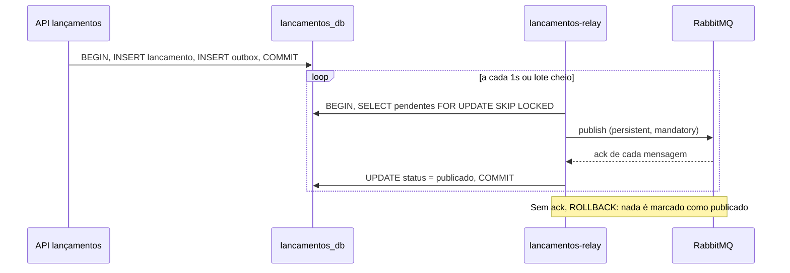

# ADR-008: Relay do outbox em processo separado, com confirmação do broker

**Status:** Aceito  
**Data:** 2026-11-04  
**Complementa:** ADR-005 (Outbox Pattern). Revisa a alternativa descartada no ADR-001.

## Contexto

A primeira versão do relay rodava dentro do processo da API de lançamentos, com `setInterval`, e tinha três defeitos:

1. **Sem publisher confirms.** `channel.publish()` devolve `true` quando o buffer local aceita a mensagem, não quando o broker a persistiu. O relay marcava a linha como publicada nesse momento. Uma queda do broker logo depois perdia o evento, o que contradiz o requisito de zero perda.
2. **Sem exclusão entre réplicas.** O `SELECT` não travava as linhas. Com N réplicas da API, as N publicavam os mesmos eventos.
3. **Acoplamento de disponibilidade.** A API só ficava pronta com o RabbitMQ conectado, e uma queda de conexão não era recuperada: o relay falhava a cada ciclo até alguém reiniciar o processo.

## Decisão

- O relay passa a ser o processo `lancamentos-relay`, com a mesma imagem da API e outro comando de entrada. A API só escreve no banco e não conhece o RabbitMQ.
- A publicação usa `ConfirmChannel` com `mandatory: true`. A linha só vira `publicado` depois que o broker confirma todas as mensagens do lote. Mensagem devolvida por falta de rota (fila ou binding ausente) é tratada como falha.
- O lote é lido com `SELECT ... FOR UPDATE SKIP LOCKED` dentro de uma transação que só dá `COMMIT` depois dos acks. Qualquer falha desfaz a transação e as linhas continuam pendentes.
- A conexão é mantida por um componente que reconecta com backoff exponencial e jitter, e o `/ready` do relay fica 503 enquanto o broker está fora.

## Alternativas

### Manter o relay dentro da API e corrigir apenas os confirms e o lock
Resolve os defeitos 1 e 2, mas mantém a API dependente do broker para ficar pronta e impede escalar leitura/escrita HTTP e publicação de forma independente. **Descartado.**

### CDC com Debezium
Continua sendo a evolução natural para altíssimo volume, mas exige Kafka Connect no ambiente local. **Adiado**, como já registrado no ADR-005.

### Lock consultivo (`pg_advisory_lock`) para eleger um único relay
Funciona, mas serializa a publicação em uma réplica e desperdiça as demais. `SKIP LOCKED` divide o trabalho e não tem eleição para falhar. **Descartado.**

## Consequências

**Positivas:**
- Zero perda no trecho banco para broker: sem ack, o evento continua pendente.
- Várias réplicas do relay dividem o trabalho sem duplicar, comprovado por teste de integração com 3 relays e 200 eventos contra um RabbitMQ real.
- A API de lançamentos continua pronta e aceitando escritas com o RabbitMQ fora do ar; os eventos ficam pendentes no outbox.
- Queda e retorno do broker são recuperados sem reiniciar processos.

**Negativas:**
- Mais um processo para operar e monitorar (healthcheck, métricas, deploy).
- Se o processo cair depois do ack e antes do `COMMIT`, o lote é publicado de novo. A entrega continua at-least-once e o consumidor segue idempotente (`eventos_processados`).
- A transação do relay fica aberta enquanto espera os acks. Com lote de 50 e broker saudável isso dura milissegundos; com o broker lento, as linhas ficam travadas apenas para outras réplicas, nunca para a API.
