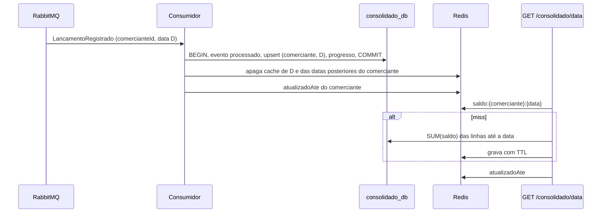

# ADR-009: Saldo do dia versus acumulado e multi-comerciante

**Status:** Aceito  
**Data:** 2026-11-05  
**Complementa:** ADR-006 (cache) e ADR-008 (relay). Detalha o contrato em [eventos.md](../eventos.md).

## Contexto

O enunciado pede "o saldo diário consolidado" de um comerciante. Duas leituras razoáveis:

1. **Resultado do dia:** créditos menos débitos de uma data.
2. **Saldo em caixa até a data:** tudo o que o comerciante acumulou desde o início, que é o que quem controla caixa quer saber ao abrir o dia.

A primeira versão entregava só o resultado do dia, chamado de `saldo`, e devolvia 404 para dias sem movimento. Além disso, não existia o conceito de comerciante: a chave primária de `saldo_diario` era a data, o cache era `saldo:{data}` e a chave de idempotência era global. Um segundo comerciante teria os valores somados ao primeiro.

## Decisão

### Requisito refinado

O consolidado devolve **as duas medidas**, com nomes que não se confundem:

| Campo | Significado |
|---|---|
| `totalCreditos`, `totalDebitos` | Movimento da data |
| `resultadoDia` | `totalCreditos - totalDebitos` da data |
| `saldoAcumulado` | Soma do `resultadoDia` de todos os dias do comerciante até a data, inclusive |
| `atualizadoAte` | Instante de lançamento do último evento já aplicado para o comerciante |

`atualizadoAte` torna a consistência eventual explícita: o cliente sabe até quando os números refletem lançamentos, em vez de supor que estão em tempo real. Se há lançamentos mais novos que `atualizadoAte`, eles ainda estão a caminho.

Dia sem movimento **não é erro**: responde 200 com zeros no dia e o acumulado vigente. Comerciante sem nenhum evento responde zeros e `atualizadoAte: null`.

Também existe `GET /consolidado?inicio=&fim=`, que devolve um item por dia (inclusive os vazios) com o acumulado correndo, limitado a 92 dias corridos (configurável em `MAX_DIAS_INTERVALO`). O limite protege o banco de uma consulta sem teto.

### Multi-comerciante

- Toda linha de negócio tem `comerciante_id`: `lancamentos`, `saldo_diario` (chave primária `(comerciante_id, data)`), a chave de idempotência (`UNIQUE (comerciante_id, idempotency_key)`), o payload do evento e as chaves de cache.
- O comerciante vem **do claim `comerciante_id` do token**, nunca do corpo da requisição. Um campo com esse nome no corpo é ignorado, e há teste para isso. Token válido sem o claim recebe 403. Nesta fase o token é emitido pelo login de desenvolvimento, que aceita escolher o comerciante; a fase de identidade troca isso pelo claim do provedor OIDC sem mexer nos serviços.
- Dados que já existiam ficam com o comerciante `padrao`, e eventos 1.0 ainda em fila são creditados a ele (ver política de versionamento em [eventos.md](../eventos.md)).

### Cálculo do acumulado: soma das linhas até a data

```sql
SELECT SUM(saldo) FROM saldo_diario WHERE comerciante_id = $1 AND data <= $2
```

A chave primária `(comerciante_id, data)` serve esse intervalo diretamente. O dia e o acumulado saem da mesma consulta, portanto do mesmo snapshot do banco.

### Cache

- Chave `saldo:{comerciante}:{data}`, com TTL de 60 s, como antes, agora por comerciante.
- Um lançamento em uma data D muda o acumulado de D e de **todas as datas posteriores**. Por isso o consumidor, depois do commit, apaga o cache de D e de todas as datas maiores do comerciante. Datas anteriores a D continuam em cache, porque não mudam. Para saber quais datas estão em cache sem varrer o Redis, cada comerciante tem um sorted set `saldo:idx:{comerciante}` com as datas em cache (score `YYYYMMDD`).
- O `atualizadoAte` fica fora do JSON do dia e vive em `saldo:ate:{comerciante}`, gravado pelo consumidor a cada evento. Assim ele nunca fica defasado dentro do TTL de um dia antigo que ainda está em cache.



## Trade-offs

- **Custo da leitura sem cache.** A soma percorre as linhas do comerciante até a data, uma por dia com movimento. Cresce com o histórico, mas é uma varredura de índice sobre poucas linhas por comerciante e, com o cache de 60 s, só acontece a cada TTL por data. Não medimos esse custo com histórico longo; o teste de carga atual usa poucas linhas por comerciante.
- **Janela de corrida no cache.** Um GET que leu o banco antes do commit pode gravar o valor antigo no cache depois da invalidação, e ele fica até o TTL. É o limite de consistência eventual já aceito (ADR-006) e o `atualizadoAte` deixa isso visível.
- **Invalidar "da data em diante" apaga mais do que o mínimo** quando há muitas datas em cache, mas só do comerciante afetado.
- **Linha de progresso por comerciante** é um ponto de escrita compartilhado entre os eventos do mesmo comerciante. Como o upsert do saldo já serializa eventos da mesma data, e o consumidor processa uma mensagem por vez por réplica, a contenção é aceitável neste volume.

## Alternativas

### Guardar o saldo acumulado em cada linha (running balance)
Leitura O(1), mas um lançamento retroativo obriga a reescrever todas as linhas posteriores do comerciante dentro da transação, com lock em uma faixa inteira. Escrita cara e propensa a contenção. **Descartado.**

### Recalcular por varredura da tabela `lancamentos`
Acopla o consolidado ao banco de lançamentos, o que o ADR-004 proíbe. **Descartado.**

### Manter só o resultado do dia
Não responde à pergunta de quem controla caixa. **Descartado.**

## Evolução: snapshots de saldo

Quando o histórico por comerciante crescer a ponto de a soma incomodar, a evolução natural é materializar **snapshots**: uma tabela `saldo_snapshot(comerciante_id, data_corte, saldo_acumulado)`, por exemplo mensal. A consulta passa a ser "snapshot mais recente até a data mais a soma do que veio depois". Um lançamento retroativo anterior ao último snapshot exige recalcular os snapshots posteriores daquele comerciante, o que pode ser feito de forma assíncrona e é raro por natureza. O contrato da API não muda.

## Consequências

**Positivas:** isolamento entre comerciantes testado, acumulado correto inclusive com lançamento retroativo, dia vazio sem erro, consistência eventual explícita na resposta.

**Negativas:** o contrato de resposta mudou (campos em camelCase, `saldo` virou `resultadoDia`, `saldoAcumulado` e `atualizadoAte` novos); a migration reescreve a chave primária de `saldo_diario`.
