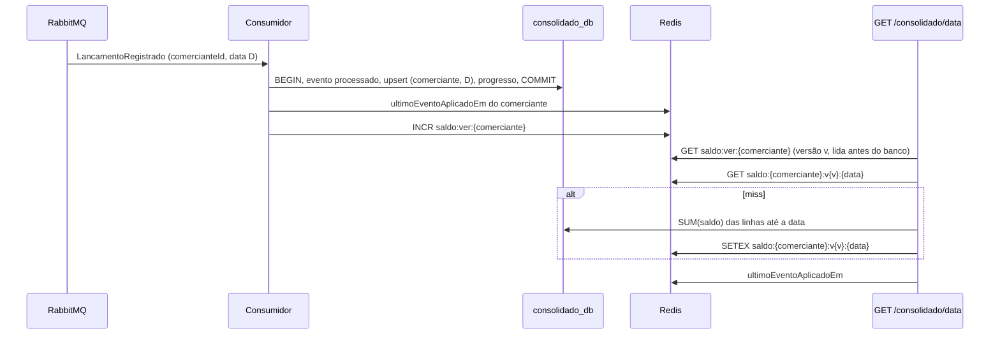

# ADR-009: Saldo do dia versus acumulado e multi-comerciante

**Status:** Aceito  
**Data:** 2026-11-05  
**Complementa:** ADR-006 (cache) e ADR-008 (relay). Detalha o contrato em [eventos.md](../eventos.md).

## Contexto

O enunciado pede "o saldo diário consolidado" de um comerciante. Duas leituras razoáveis:

1. **Resultado do dia:** créditos menos débitos de uma data.
2. **Saldo em caixa até a data:** tudo o que o comerciante acumulou desde o início, que é o que quem controla caixa quer saber ao abrir o dia.

A primeira versão entregava só o resultado do dia, chamado de `saldo`, e devolvia 404 para dias sem movimento. Além disso, não existia o conceito de comerciante: a chave primária de `saldo_diario` era a data, o cache era `saldo:{data}` e a chave de idempotência era global. Um segundo comerciante teria os valores somados ao primeiro.

## Decisão

### Requisito refinado

O consolidado devolve **as duas medidas**, com nomes que não se confundem:

| Campo | Significado |
|---|---|
| `totalCreditos`, `totalDebitos` | Movimento da data |
| `resultadoDia` | `totalCreditos - totalDebitos` da data |
| `saldoAcumulado` | Soma do `resultadoDia` de todos os dias do comerciante até a data, inclusive |
| `ultimoEventoAplicadoEm` | O **maior `createdAt`** entre os eventos já aplicados para o comerciante |

`ultimoEventoAplicadoEm` torna a consistência eventual visível: o cliente vê até que ponto os números já refletem lançamentos, em vez de supor que estão em tempo real. **Não é uma garantia de completude.** Como é o maior `createdAt` aplicado, e não "tudo até este instante foi aplicado", um evento mais antigo que ele ainda pode estar em trânsito quando os eventos chegam fora de ordem (relay com várias réplicas, reentrega, retry, DLQ reprocessada). Use-o como indicador de atraso aproximado, não como marca d'água para concluir que lançamentos anteriores a ele estão incluídos. Uma marca d'água verdadeira exigiria sequência por comerciante no produtor, o que fica como evolução.

Dia sem movimento **não é erro**: responde 200 com zeros no dia e o acumulado vigente. Comerciante sem nenhum evento responde zeros e `ultimoEventoAplicadoEm: null`.

Também existe `GET /consolidado?inicio=&fim=`, que devolve um item por dia (inclusive os vazios) com o acumulado correndo, limitado a 92 dias corridos (configurável em `MAX_DIAS_INTERVALO`). O limite protege o banco de uma consulta sem teto.

### Multi-comerciante

- Toda linha de negócio tem `comerciante_id`: `lancamentos`, `saldo_diario` (chave primária `(comerciante_id, data)`), a chave de idempotência (`UNIQUE (comerciante_id, idempotency_key)`), o payload do evento e as chaves de cache.
- O comerciante vem **do claim `comerciante_id` do token**, nunca do corpo da requisição. Um campo com esse nome no corpo é ignorado, e há teste para isso. Token válido sem o claim recebe 403. Nesta fase o token é emitido pelo login de desenvolvimento, que aceita escolher o comerciante; a fase de identidade troca isso pelo claim do provedor OIDC sem mexer nos serviços.
- Dados que já existiam ficam com o comerciante `padrao`, e eventos 1.0 ainda em fila são creditados a ele (ver política de versionamento em [eventos.md](../eventos.md)).

### Cálculo do acumulado: soma das linhas até a data

```sql
SELECT SUM(saldo) FROM saldo_diario WHERE comerciante_id = $1 AND data <= $2
```

A chave primária `(comerciante_id, data)` serve esse intervalo diretamente. O dia e o acumulado saem da mesma consulta, portanto do mesmo snapshot do banco.

### Cache

- Chave `saldo:{comerciante}:v{versao}:{data}`, com TTL de 60 s. A versão vem de um contador por comerciante, `saldo:ver:{comerciante}`.
- Um lançamento em uma data D muda o acumulado de D e de **todas as datas posteriores**. Em vez de apagar chaves, o consumidor **incrementa o contador** do comerciante depois do commit. As leituras sempre usam a versão atual; tudo o que estava em cache sob a versão anterior deixa de ser lido e expira pelo TTL. Isso cobre o lançamento retroativo sem precisar saber quais datas estão em cache, e dispensa o índice de datas e a varredura que existiam antes.
- **Por que versão e não apagar chaves.** Com `DEL`, havia uma corrida: um GET que consultou o banco antes do commit podia gravar o valor antigo depois da invalidação, e ele ficava no cache até o TTL, violando o RNF-05. Com a versão, o leitor **lê a versão antes de consultar o banco** e grava sob essa versão. Se um evento for aplicado nesse meio tempo, o consumidor já terá avançado a versão (o incremento vem depois do commit), e a gravação atrasada cai numa chave de versão velha que nenhuma leitura nova usa. Ordem do consumidor: commit, depois `ultimoEventoAplicadoEm`, depois o incremento da versão.
- Se o contador some (flush, eviction, Redis novo), ele nasce com o relógio em milissegundos (`SET NX`), de modo que uma versão nova nunca coincide com uma anterior mesmo que restem chaves antigas.
- O `ultimoEventoAplicadoEm` fica fora do JSON do dia e vive em `saldo:ultimo:{comerciante}`, gravado pelo consumidor a cada evento. Assim ele não fica defasado dentro do TTL de um dia que ainda está em cache.



## Trade-offs

- **Custo da leitura sem cache.** A soma percorre as linhas do comerciante até a data, uma por dia com movimento. Cresce com o histórico, mas só acontece a cada TTL por data, por causa do cache de 60 s. O custo foi medido com 3 anos de histórico (seção abaixo).
- **Invalidação grossa.** Qualquer evento avança a versão do comerciante inteiro, inclusive para datas anteriores à do lançamento, cujo valor não mudou. É mais invalidação do que o mínimo, e custa leituras ao banco que um `DEL` preciso evitaria. Em troca, a corrida de gravação atrasada deixa de existir e o código fica mais simples. O custo é por comerciante: o cache dos outros não é tocado. Se o histórico consultado de comerciantes muito ativos virar problema, a evolução é combinar a versão com snapshots (abaixo).
- **Redis fora do ar na hora do evento.** Se o incremento da versão falhar (consumidor sem acesso ao Redis), entradas já em cache continuam sob a versão antiga e podem ser servidas até o TTL de 60 s. O consumidor registra o aviso e o processamento do evento não é desfeito. É o único caminho que ainda admite staleness, limitado ao TTL e restrito à falha do próprio Redis.
- **Chaves antigas ocupam memória até o TTL.** Cada versão deixa chaves que expiram sozinhas em até 60 s; não há limpeza ativa.
- **Linha de progresso por comerciante** é um ponto de escrita compartilhado entre os eventos do mesmo comerciante. Como o upsert do saldo já serializa eventos da mesma data, e o consumidor processa uma mensagem por vez por réplica, a contenção é aceitável neste volume.

## Medição com histórico longo (3 anos)

Cenário `tests/load/historico-longo.js`: um comerciante com 1095 dias consecutivos de movimento (1095 créditos e 219 débitos, 2023-01-01 a 2025-12-30), registrados pela API e consolidados pelo fluxo normal. O k6 consulta as 1095 datas distintas a 50 req/s (cada uma lida do banco pela primeira vez, ou seja, cache frio) e confere o acumulado de cada resposta contra o valor calculado em centavos no próprio script: 1101 respostas conferidas, **0 divergências**. O contraponto é a última data repetida a 50 req/s, já em cache.

| Medida | Cache frio (soma até 1095 linhas) | Cache quente |
|---|---|---|
| Mediana HTTP | 8,97 ms | 4,76 ms |
| p95 HTTP | 321,55 ms | 246,73 ms |
| Falhas | 0% | 0% |

A consulta isolada no PostgreSQL, com `EXPLAIN ANALYZE`, levou **0,24 ms** na primeira data (1 linha), **1,17 ms** no meio do histórico (547 linhas) e **0,84 ms** na última (1095 linhas). Isso é o custo de somar três anos de linhas, e é pequeno.

Como ler os números:

- A diferença entre cache frio e quente na **mediana**, cerca de 4 ms, é o custo de ir ao banco com histórico longo (ida e volta ao PostgreSQL, planejamento e a soma). O custo da soma em si, medido no banco, é da ordem de 1 ms.
- Os **p95** de 246 ms (cache quente) e 321 ms (cache frio) estão muito acima do que o caminho justifica, e o cache quente, que só lê o Redis, não deveria ficar tão perto do frio. Esses p95 foram medidos antes de eu investigar e corrigir uma degradação de latência na stack (`docs/evidencias/regressao-latencia.txt`) e variaram muito entre execuções idênticas, de modo que não são um número de capacidade. Por isso a conclusão sustentada pelos dados é a da mediana e do `EXPLAIN`: **a soma de 3 anos de histórico não é gargalo**, e ambos os p95 ficam abaixo do limite de 500 ms. Não afirmo um p95 de capacidade.
- A tabela `saldo_diario` do teste é pequena e o planejador escolheu varredura sequencial para as datas mais recentes. Com muitos comerciantes e milhões de linhas, o índice da chave primária `(comerciante_id, data)` é o caminho esperado; esse cenário não foi medido.
- Os snapshots (abaixo) continuam sendo a evolução para históricos muito maiores ou comerciantes de altíssimo volume, mas esta medição não os justifica agora.

Evidências em `docs/evidencias/`: `k6-historico-saida.txt`, `k6-historico-resumo.json`, `saldo-acumulado-explain.txt`.

## Alternativas

### Guardar o saldo acumulado em cada linha (running balance)
Leitura O(1), mas um lançamento retroativo obriga a reescrever todas as linhas posteriores do comerciante dentro da transação, com lock em uma faixa inteira. Escrita cara e propensa a contenção. **Descartado.**

### Recalcular por varredura da tabela `lancamentos`
Acopla o consolidado ao banco de lançamentos, o que o ADR-004 proíbe. **Descartado.**

### Manter só o resultado do dia
Não responde à pergunta de quem controla caixa. **Descartado.**

## Evolução: snapshots de saldo

Quando o histórico por comerciante crescer a ponto de a soma incomodar, a evolução natural é materializar **snapshots**: uma tabela `saldo_snapshot(comerciante_id, data_corte, saldo_acumulado)`, por exemplo mensal. A consulta passa a ser "snapshot mais recente até a data mais a soma do que veio depois". Um lançamento retroativo anterior ao último snapshot exige recalcular os snapshots posteriores daquele comerciante, o que pode ser feito de forma assíncrona e é raro por natureza. O contrato da API não muda.

## Consequências

**Positivas:** isolamento entre comerciantes testado, acumulado correto inclusive com lançamento retroativo, dia vazio sem erro, consistência eventual explícita na resposta.

**Negativas:** o contrato de resposta mudou (campos em camelCase, `saldo` virou `resultadoDia`, `saldoAcumulado` e `ultimoEventoAplicadoEm` novos); a migration reescreve a chave primária de `saldo_diario`.
