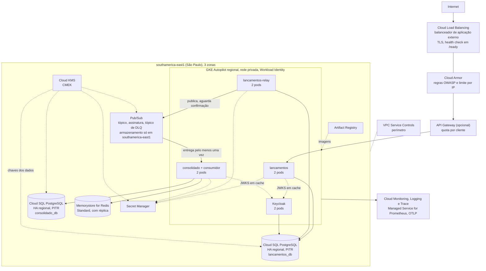
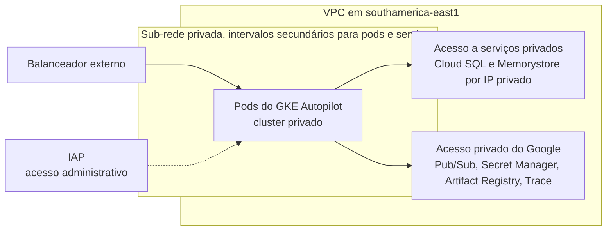

# Arquitetura alvo: Google Cloud

Mapeamento do ambiente local para o Google Cloud na região `southamerica-east1` (São Paulo), com as adaptações de alta disponibilidade para produção. A empresa usa o Google Cloud, então esta é a nuvem alvo. Os números de capacidade e custo estão em [dimensionamento.md](dimensionamento.md) e [custos.md](custos.md), e a recuperação de desastres em [disaster-recovery.md](disaster-recovery.md). Nada aqui foi implantado: é desenho alvo, e não há infraestrutura como código do Google Cloud no repositório ([evolucoes.md](evolucoes.md)).

**O que muda no código em relação ao ambiente local.** Quase nada, com uma exceção importante: em produção o broker é o **Pub/Sub**, e o código de hoje só tem o adaptador de RabbitMQ (AMQP). Criar o adaptador do Pub/Sub é trabalho de código, descrito no [ADR-012](adrs/ADR-012-broker-em-producao-no-gcp.md). Todo o resto (PostgreSQL, Redis, OIDC, OTLP, Prometheus) são protocolos abertos e entram por configuração.

## Decisão de plataforma: GKE Autopilot ou Cloud Run

Três dos quatro componentes de aplicação são **processos contínuos**: o `lancamentos-relay` consulta o outbox a cada segundo, o consumidor do consolidado mantém uma assinatura aberta e controla quantas mensagens processa por vez, e o Keycloak mantém caches e sessões. O Cloud Run foi pensado para atender requisições, e fora delas a CPU é limitada, a menos que se configure a CPU sempre alocada com instâncias mínimas, que é pagar por instância ociosa. O escalonamento do Cloud Run também é por requisições simultâneas, e não pelo atraso da fila.

| Critério | GKE Autopilot | Cloud Run |
|---|---|---|
| Relay (laço contínuo, sem requisição HTTP) | Natural: um pod comum com `/ready` | Exige CPU sempre alocada e instância mínima, ou o recurso de pools de trabalho (confirmar a disponibilidade geral na documentação) |
| Consumidor com assinatura aberta e `prefetch` equivalente | Natural | Possível com CPU sempre alocada, mas o escalonamento não vê o atraso da fila |
| API de lançamentos e de leitura (HTTP) | Boa. Escala por CPU ou por métrica | Muito boa. Escala a zero e por requisições |
| Um só modelo de operação | Sim, para os quatro componentes | Não: dois modelos, ou o relay fica fora |
| Identidade sem chave | Workload Identity Federation for GKE | Conta de serviço por serviço |
| Custo ocioso | Cobra os recursos pedidos pelos pods | Escala a zero nas APIs |
| Acesso privado ao Cloud SQL e ao Memorystore | Rede da própria VPC | Conector de VPC ou saída direta para a VPC |

**Decisão: GKE Autopilot para os quatro componentes** (`lancamentos`, `lancamentos-relay`, `consolidado` com o consumidor e o Keycloak). O Autopilot elimina a gestão de nós (o Google cuida de patches, capacidade e segurança dos nós), cobra pelos recursos que os pods pedem e dá um único modelo de operação, probes e implantação. O Cloud Run continua sendo uma opção legítima **só para as APIs HTTP**; entraria se o custo ocioso virasse relevante, e o relay e o consumidor ficariam no GKE de qualquer forma. Esta decisão é uma escolha entre duas boas opções, e o argumento a favor do Autopilot é a simplicidade operacional para uma equipe pequena.

O repositório de referência do mesmo autor para outro desafio escolheu o Cloud Run para o consolidado porque ali o consumo era acionado por eventos (push). Aqui o consumidor é uma assinatura de pull com controle de fluxo, que é o modelo do código atual, e o consolidado também serve a API de leitura no mesmo processo.

## Diagrama de implantação





O Keycloak aparece como componente próprio porque é o que o código usa hoje. O **Identity Platform não substitui o Keycloak** neste caso: ele é voltado a usuários finais, e o consumo desta solução é de máquina a máquina (*client credentials*). Detalhes em [custos.md](custos.md) e no [ADR-010](adrs/ADR-010-autenticacao-e-autorizacao-de-consumo.md).

---

## Mapeamento local para Google Cloud

| Local | Google Cloud | Notas |
|---|---|---|
| `lancamentos` (contêiner) | GKE Autopilot | Escala por CPU com HPA |
| `lancamentos-relay` (contêiner) | GKE Autopilot | Várias réplicas são seguras por causa do `FOR UPDATE SKIP LOCKED` |
| `consolidado` (contêiner) | GKE Autopilot | API de leitura e consumidor no mesmo processo |
| Keycloak (contêiner) | GKE Autopilot | Modo de produção, com PostgreSQL e TLS. O acesso ao console administrativo é pelo IAP, sem exposição pública |
| PostgreSQL único com 2 bancos | **Duas instâncias Cloud SQL for PostgreSQL**, HA regional | Local: dois bancos na mesma instância por simplicidade. Produção: instâncias separadas, como pede o [ADR-004](adrs/ADR-004-banco-por-servico.md). O banco do Keycloak fica como um terceiro banco na instância de lançamentos. Conexão por IP privado e pelo Cloud SQL Auth Proxy ou conector, com autenticação IAM quando possível |
| RabbitMQ (single-node) | **Pub/Sub** | Tópico de eventos, assinatura do consolidado e tópico de mensagens mortas. Exige o adaptador descrito no [ADR-012](adrs/ADR-012-broker-em-producao-no-gcp.md). O RabbitMQ continua no ambiente local e nos testes |
| Redis (single-node) | Memorystore for Redis, nível Standard | Réplica em outra zona com failover automático. Cluster não é necessário a este volume |
| Proxy local | Cloud Load Balancing (balanceador de aplicação externo) | Roteamento por caminho, TLS, health check em `/ready` (ver nota abaixo) |
| (sem equivalente) | Cloud Armor | Regras OWASP pré-configuradas e limite por IP na borda |
| (sem equivalente) | API Gateway (padrão) ou Apigee | Quota e throttling por cliente, que tirariam do código o rate limit em memória. Ver abaixo |
| Prometheus e Grafana (profile) | Cloud Monitoring com Managed Service for Prometheus | As métricas `*_http_*`, de outbox e de lag continuam as mesmas, e as regras de `observability/alerts.yml` portam para regras gerenciadas |
| Jaeger (profile) | Cloud Trace via OTLP | O código já exporta OTLP; só muda o destino |
| `.env` e segredos do compose | Secret Manager | Montado pelo driver CSI do Secret Manager ou lido pela API com Workload Identity |
| Chaves de criptografia | Cloud KMS com CMEK | Cloud SQL, Pub/Sub, Memorystore, Secret Manager e buckets |
| Dockerfile | Artifact Registry | Registro privado com varredura de vulnerabilidades. A imagem é multi-stage, roda como o usuário `node` e leva só o código compilado e as dependências de produção |
| Logs de auditoria | Cloud Audit Logs com bucket de retenção bloqueada | Ver [seguranca.md](seguranca.md) |

> **Health check do balanceador.** Pode usar `/ready`: o do consolidado depende só do PostgreSQL e da conexão com o broker, e o Redis, que é cache, fica de fora de propósito. Uma queda do cache não tira pods do balanceador (cenário C do [teste de resiliência](../tests/resiliencia/resiliencia.ps1)). `/health` serve como sonda de vivacidade do Kubernetes.

> **Bancos separados.** Um VACUUM agressivo ou um pool esgotado numa instância não afeta a outra, as políticas de backup são independentes e a capacidade acompanha o perfil de cada uma: lançamentos é de escrita, consolidado é de leitura.

### Cloud Armor, API Gateway e Apigee

- **Cloud Armor** fica no balanceador e cobre o que é da borda: regras OWASP pré-configuradas e limite de taxa por IP. Ele **não** enxerga o claim do token, então não limita por cliente (`azp`).
- Para **quota por cliente**, a escolha é entre dois produtos. O **API Gateway** é simples e barato e atende quota e validação de JWT; é o padrão desta proposta. O **Apigee** é uma plataforma de gestão de APIs (produtos de API, portal do desenvolvedor, análise, monetização) e só se justifica se houver muitos integradores externos que precisem de autoatendimento. A combinação do API Gateway com o balanceador e o Cloud Armor deve ser conferida na documentação antes de fechar o desenho.
- Enquanto nenhum dos dois existir, o limite continua em memória por instância, o que está em [seguranca.md](seguranca.md) como limitação conhecida.

---

## Identidade e acesso: menor privilégio

Cada serviço usa uma **conta de serviço do Google própria**, ligada à conta de serviço do Kubernetes por **Workload Identity Federation for GKE**. Não existe chave de conta de serviço baixada nem segredo de nuvem em variável de ambiente.

| Serviço | Papéis (em nível de recurso, não de projeto) |
|---|---|
| `lancamentos` | acesso a segredos (`secretmanager.secretAccessor`) só dos segredos de lançamentos; cliente do Cloud SQL (`cloudsql.client`) da instância de lançamentos; escritor de métricas, logs e traces |
| `lancamentos-relay` | idem, mais publicador (`pubsub.publisher`) só no tópico de eventos |
| `consolidado` | segredos do consolidado; cliente do Cloud SQL do consolidado; assinante (`pubsub.subscriber`) só na assinatura do consolidado; publicador só no tópico de mensagens mortas |
| `keycloak` | segredos do Keycloak; cliente do Cloud SQL |

Exemplo de ligação (ilustrativo, nomes de exemplo):

```
gcloud iam service-accounts add-iam-policy-binding relay@PROJETO.iam.gserviceaccount.com \
  --role roles/iam.workloadIdentityUser \
  --member "serviceAccount:PROJETO.svc.id.goog[caixa/lancamentos-relay]"
```

Nenhum serviço administra tópicos, assinaturas nem segredos: isso é feito pela infraestrutura como código. O código de hoje declara a fila em tempo de execução (`assertQueue`); o adaptador do Pub/Sub não deve fazer isso ([ADR-012](adrs/ADR-012-broker-em-producao-no-gcp.md)).

## Rede e perímetro

- **Cluster privado**, sem IP público nos nós. O acesso aos serviços do Google é pelo acesso privado do Google; o Cloud SQL e o Memorystore são alcançados por IP privado (acesso a serviços privados).
- **Saída para a internet:** nenhum componente precisa sair para a internet (o JWKS é interno e o Pub/Sub, o Secret Manager e o Artifact Registry são acessados de forma privada). Por isso o **Cloud NAT não está nos cenários de custo**. Ele entra só se algum componente passar a precisar de saída (por exemplo, envio de e-mail pelo Keycloak).
- **VPC Service Controls:** um perímetro de serviço em torno de Cloud SQL, Pub/Sub, Secret Manager, Cloud KMS e Cloud Storage reduz o risco de exfiltração de dados por credencial comprometida. Exige planejar as exceções (por exemplo, o pipeline de implantação) e começar em modo de teste (*dry run*).
- **Acesso administrativo:** IAP para o console do Keycloak e para o acesso aos recursos, sem bastion e sem SSH exposto.
- **Políticas de rede** do Kubernetes entre namespaces: os pods de lançamentos não falam com o Redis, e os do consolidado não escrevem no banco de lançamentos.

---

## Escalabilidade e alta disponibilidade

**Lançamentos (escrita):**
- HPA por CPU (alvo de 60%), no mínimo 2 pods em zonas diferentes.
- O relay é um serviço à parte: N pods são N relays em paralelo, que dividem o trabalho com `SKIP LOCKED` sem duplicar eventos.
- Cloud SQL com HA regional (réplica síncrona em outra zona e failover automático).

**Consolidado (leitura):**
- Escala por CPU e, para o consumidor, pelo atraso da assinatura (métrica do Pub/Sub exposta ao HPA), no mínimo 2 pods.
- O Redis absorve a leitura repetida; com falha do cache a leitura cai para o banco.
- O controle de fluxo da assinatura em 1 mensagem por vez equivale ao `prefetch=1` de hoje: N pods são N mensagens em processamento, sem coordenação.

**Pub/Sub:**
- Serviço regional gerenciado, com as mensagens replicadas entre zonas. A retenção da assinatura e do tópico guarda as mensagens enquanto o consolidado está fora.
- A assinatura tem política de mensagens mortas. O reprocessamento é manual hoje ([disaster-recovery.md](disaster-recovery.md)).

---

## Equivalência em outras nuvens

A solução fala protocolos abertos (HTTP, OIDC, PostgreSQL, AMQP 0-9-1 no ambiente local, protocolo do Redis, OTLP) e roda em contêineres comuns. **Nenhum componente do código depende de um serviço proprietário de uma nuvem específica**, exceto o adaptador do broker, que é a única parte a escrever para cada nuvem. A tabela abaixo é só uma equivalência de componentes; não há estimativa de custo para as outras duas nuvens.

| Componente | Google Cloud (este documento) | AWS | Azure |
|---|---|---|---|
| Computação de contêineres | GKE Autopilot (ou Cloud Run para as APIs) | ECS Fargate | Azure Container Apps (ou AKS) |
| PostgreSQL gerenciado | Cloud SQL for PostgreSQL, HA regional | RDS for PostgreSQL, Multi-AZ | Azure Database for PostgreSQL, servidor flexível |
| Broker de mensagens | Pub/Sub (produção) | Amazon MQ for RabbitMQ (mesmo protocolo do código) ou SNS e SQS (exige adaptador) | Sem RabbitMQ gerenciado de primeira parte: RabbitMQ próprio em AKS ou VM. O Service Bus fala AMQP 1.0, não o 0-9-1 do código, então exigiria adaptador |
| Redis | Memorystore for Redis | ElastiCache | Azure Cache for Redis (ou Azure Managed Redis) |
| Identidade (OIDC) | Keycloak em contêiner. O Identity Platform é para usuários finais | Keycloak em contêiner (ou Cognito, com ajustes de claims) | Keycloak em contêiner (ou Microsoft Entra ID, com ajustes de claims e escopos) |
| Segredos | Secret Manager | Secrets Manager | Key Vault |
| Chaves de criptografia | Cloud KMS (CMEK) | KMS | Key Vault ou Managed HSM |
| Borda e WAF | Cloud Load Balancing com Cloud Armor | ALB com WAF | Application Gateway com WAF ou Front Door |
| Observabilidade | Cloud Monitoring, Logging e Trace (OTLP e Prometheus gerenciado) | CloudWatch e X-Ray (via coletor OpenTelemetry) | Azure Monitor e Application Insights (OTLP) |
| Auditoria | Cloud Audit Logs com bucket de retenção bloqueada | CloudTrail com bucket S3 Object Lock | Activity Log com armazenamento imutável |

O ponto de atenção é o broker: nas três nuvens a opção sem alterar código é o RabbitMQ, que só tem versão gerenciada de primeira parte em uma delas (ver a tabela acima) e seria operado pela equipe nas outras duas. A troca por um serviço nativo (Pub/Sub, SNS e SQS, Service Bus) mexe no relay e no consumidor e está discutida no [ADR-003](adrs/ADR-003-rabbitmq-vs-kafka-vs-pubsub.md) e no [ADR-012](adrs/ADR-012-broker-em-producao-no-gcp.md). As equivalências de identidade que não são o Keycloak mudam a forma dos claims e dos escopos, como descrito no [ADR-010](adrs/ADR-010-autenticacao-e-autorizacao-de-consumo.md).

---

## Estimativa de custos

Ver [custos.md](custos.md).
