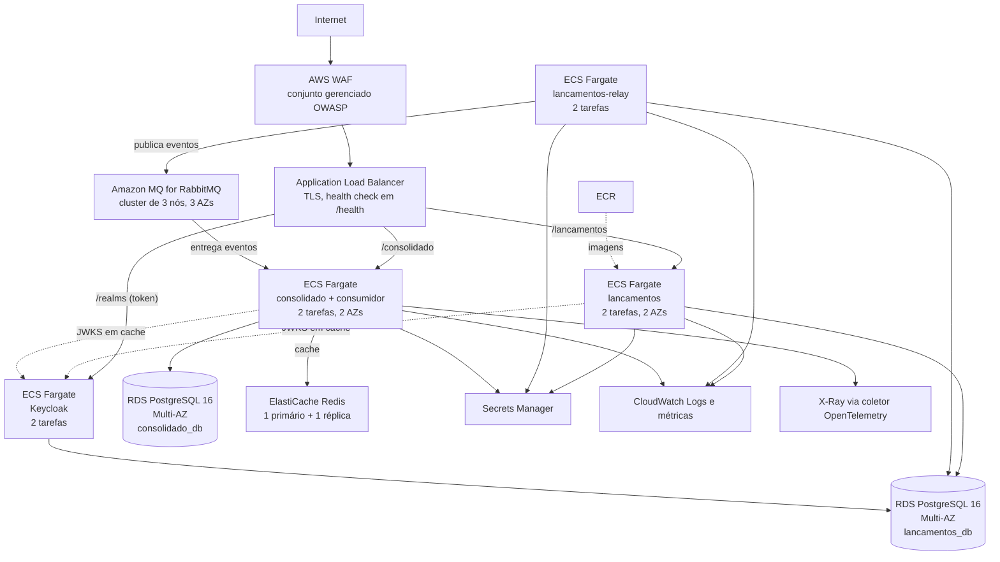
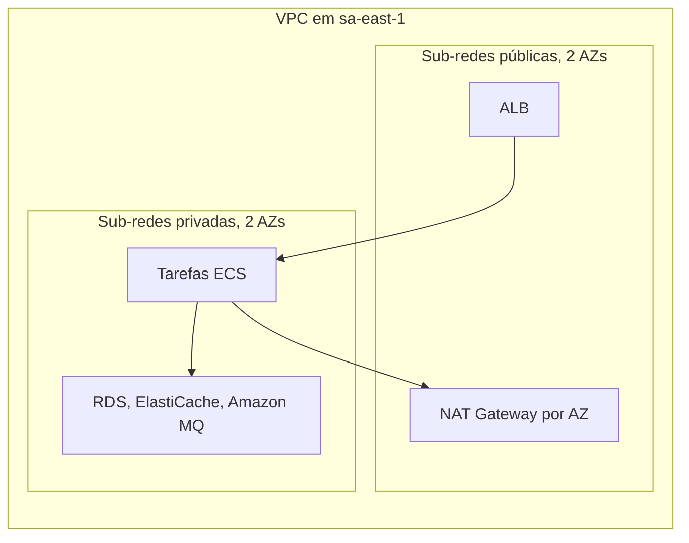

# Arquitetura alvo: AWS

Mapeamento do ambiente local para serviços AWS na região `sa-east-1` (São Paulo), com as adaptações de alta disponibilidade para produção. Os números de capacidade e custo estão em [dimensionamento.md](dimensionamento.md) e [custos.md](custos.md), e a recuperação de desastres em [disaster-recovery.md](disaster-recovery.md). Nada aqui foi implantado: é desenho alvo, e não há Terraform da AWS no repositório ([evolucoes.md](evolucoes.md)).

## Diagrama





O Keycloak aparece como componente próprio porque é o que o código usa hoje. A alternativa gerenciada (Cognito) exige ajustes na validação do JWT e está comparada em [custos.md](custos.md).

---

## Mapeamento local para AWS

| Local | AWS | Notas |
|---|---|---|
| `lancamentos` (contêiner) | ECS Fargate | Escala por contagem de tarefas |
| `lancamentos-relay` (contêiner) | ECS Fargate | Várias réplicas são seguras por causa do `FOR UPDATE SKIP LOCKED` |
| `consolidado` (contêiner) | ECS Fargate | API de leitura e consumidor no mesmo processo |
| Keycloak (contêiner) | ECS Fargate | Modo de produção, com PostgreSQL e TLS |
| PostgreSQL único com 2 bancos | **Dois RDS PostgreSQL 16 separados**, Multi-AZ | Local: dois bancos na mesma instância por simplicidade. Produção: instâncias separadas, como pede o [ADR-004](adrs/ADR-004-banco-por-servico.md). O banco do Keycloak fica como um terceiro schema na instância de lançamentos |
| RabbitMQ (single-node) | Amazon MQ for RabbitMQ, cluster de 3 nós | Quorum queues em 3 AZs. O tipo de instância de cluster, o menor listado em `sa-east-1`, é o `mq.m7g.medium`; o `mq.t3.micro` só existe como instância única ([custos.md](custos.md)) |
| Redis (single-node) | ElastiCache Redis, 1 primário e 1 réplica | Failover automático. Cluster Mode com vários shards não é necessário a este volume |
| Proxy local | ALB | Roteamento por caminho, TLS, health check em `/health` (ver nota abaixo) |
| Prometheus e Grafana (profile) | CloudWatch e, opcionalmente, Prometheus gerenciado | As métricas `*_http_*`, de outbox e de lag continuam as mesmas |
| Jaeger (profile) | X-Ray via coletor OpenTelemetry (ADOT) | O código já exporta OTLP; só muda o destino |
| `.env` e segredos do compose | Secrets Manager | Referenciado nas definições de tarefa por `secrets:` |
| Dockerfile | ECR | Registro privado, com varredura de vulnerabilidades. A imagem é multi-stage, roda como o usuário `node` e leva só o código compilado e as dependências de produção |
| (sem equivalente) | API Gateway, opcional | Throttling por cliente e plano de uso, que tirariam do código o rate limit em memória |

> **Health check do ALB.** Pode usar `/ready`: o do consolidado depende só do PostgreSQL e da conexão com o broker, e o Redis, que é cache, fica de fora de propósito. Uma queda do cache não tira tarefas do balanceador (cenário C do [teste de resiliência](../tests/resiliencia/resiliencia.ps1)). `/health` serve como liveness do ECS.

> **Bancos separados.** Um VACUUM agressivo ou um pool esgotado numa instância não afeta a outra, as políticas de backup são independentes e a capacidade acompanha o perfil de cada uma: lançamentos é de escrita, consolidado é de leitura.

---

## IAM: menor privilégio

Cada serviço assume um papel de tarefa próprio, restrito aos segredos do próprio serviço.

```json
{
  "Effect": "Allow",
  "Action": ["secretsmanager:GetSecretValue"],
  "Resource": ["arn:aws:secretsmanager:sa-east-1:ACCOUNT:secret:caixa/lancamentos/*"]
}
```

Nenhum serviço escreve em segredos nem acessa recursos do outro. A comunicação com RDS, Amazon MQ e Redis usa grupos de segurança com entrada restrita à porta e à origem exata:

| Grupo de segurança | Entrada | Saída |
|---|---|---|
| `lancamentos` | ALB na porta 3001 | RDS lançamentos (5432), Keycloak (8080) para o JWKS |
| `lancamentos-relay` | rede interna na porta 3003 (métricas e `/ready`) | RDS lançamentos (5432), Amazon MQ (5671) |
| `consolidado` | ALB na porta 3002 | RDS consolidado (5432), Amazon MQ (5671), Redis (6379), Keycloak (8080) para o JWKS |
| `keycloak` | ALB na porta 8080 | RDS (5432) |

---

## Escalabilidade e alta disponibilidade

**Lançamentos (escrita):**
- Escala automática por CPU (alvo de 60%), no mínimo 2 tarefas em 2 AZs.
- O relay é um serviço à parte: N tarefas são N relays em paralelo, que dividem o trabalho com `SKIP LOCKED` sem duplicar eventos.
- RDS Multi-AZ com failover automático.

**Consolidado (leitura):**
- Escala por CPU e por requisições por alvo, no mínimo 2 tarefas.
- O cache Redis absorve a leitura repetida; com falha do cache a leitura cai para o banco.
- `prefetch=1` por consumidor: N tarefas são N mensagens em processamento paralelo, sem coordenação.

**RabbitMQ:**
- Amazon MQ com 3 nós em 3 AZs e quorum queues. As mensagens persistem enquanto a maioria dos nós (2 de 3) estiver de pé.
- A DLQ `consolidado.lancamentos.dlq` é durável. O reprocessamento é manual hoje ([disaster-recovery.md](disaster-recovery.md)).

---

## Equivalência em outras nuvens

A solução fala protocolos abertos (HTTP, OIDC, PostgreSQL, AMQP 0-9-1, protocolo do Redis, OTLP) e roda em contêineres comuns. **Nenhum componente do código depende de um serviço proprietário da AWS**: os serviços da tabela de mapeamento acima são a forma gerenciada de rodar o mesmo software, e trocá-los é questão de configuração e de operação, não de código. A tabela abaixo é só uma equivalência de componentes; não há estimativa de custo para estas nuvens.

| Componente | AWS (este documento) | Azure | Google Cloud |
|---|---|---|---|
| Computação de contêineres | ECS Fargate | Azure Container Apps (ou AKS) | Cloud Run (ou GKE Autopilot) |
| PostgreSQL gerenciado | RDS for PostgreSQL | Azure Database for PostgreSQL, servidor flexível | Cloud SQL for PostgreSQL |
| Broker de mensagens | Amazon MQ for RabbitMQ | Sem RabbitMQ gerenciado de primeira parte: RabbitMQ próprio em AKS ou VM. O Service Bus fala AMQP 1.0, não o 0-9-1 do código, então exigiria trocar o cliente | Sem RabbitMQ gerenciado de primeira parte: RabbitMQ próprio em GKE ou VM. O Pub/Sub não fala AMQP, então exigiria reescrever o relay e o consumidor |
| Redis | ElastiCache | Azure Cache for Redis (ou Azure Managed Redis) | Memorystore for Redis |
| Identidade (OIDC) | Keycloak em contêiner (ou Cognito, com ajustes) | Keycloak em contêiner (ou Microsoft Entra ID, com ajustes de claims e escopos) | Keycloak em contêiner (ou Identity Platform, com ajustes) |
| Segredos | Secrets Manager | Key Vault | Secret Manager |
| Observabilidade | CloudWatch e X-Ray (via coletor OpenTelemetry) | Azure Monitor e Application Insights (OTLP) | Cloud Monitoring, Cloud Logging e Cloud Trace (OTLP) |

O ponto de atenção é o broker: nas três nuvens a opção sem alterar código é o RabbitMQ, gerenciado na AWS e operado pela equipe nas outras duas. A troca por um serviço nativo de fila (SQS e SNS, Service Bus, Pub/Sub) está discutida no [ADR-003](adrs/ADR-003-rabbitmq-vs-kafka-vs-sqs.md) e mexe no relay e no consumidor. As equivalências de identidade que não são o Keycloak mudam a forma dos claims e dos escopos, como descrito no [ADR-010](adrs/ADR-010-autenticacao-e-autorizacao-de-consumo.md).

---

## Estimativa de custos

Ver [custos.md](custos.md).
