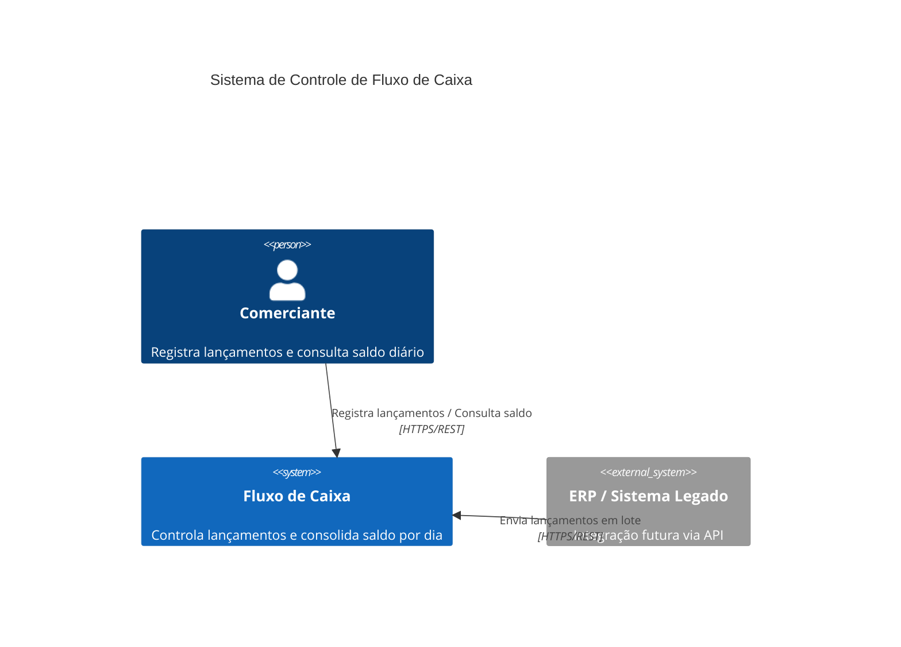
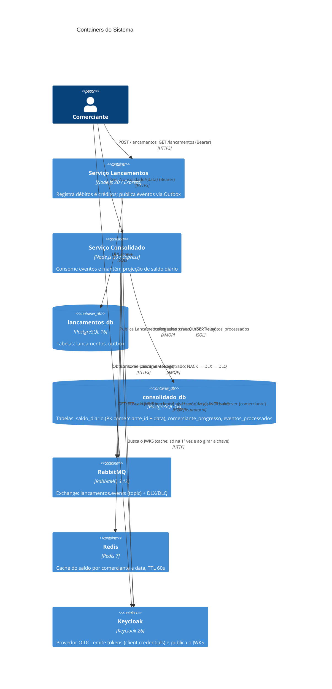
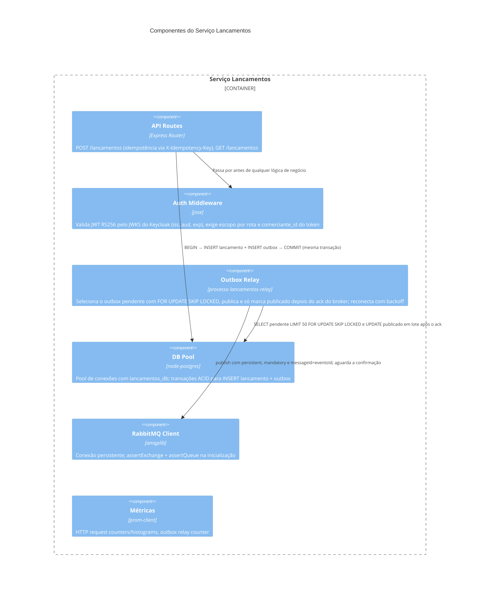
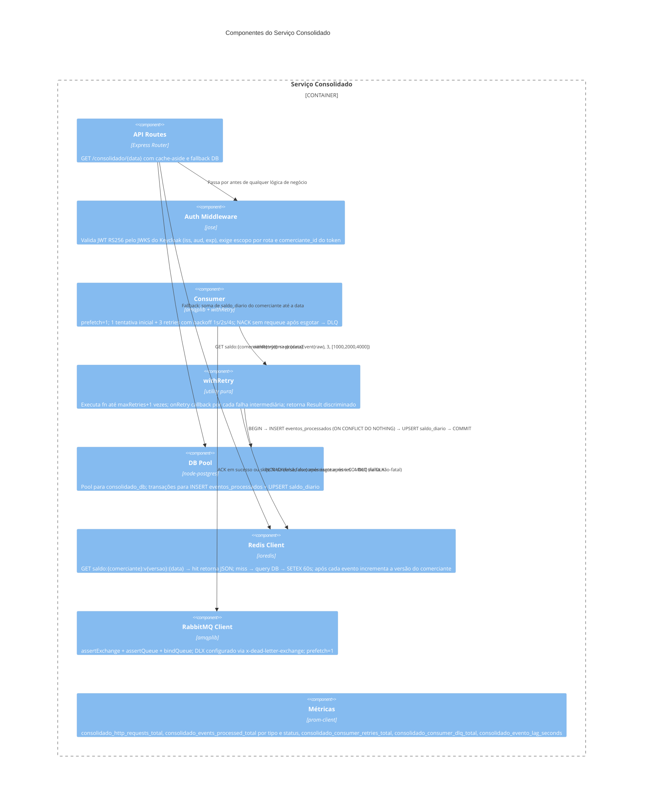
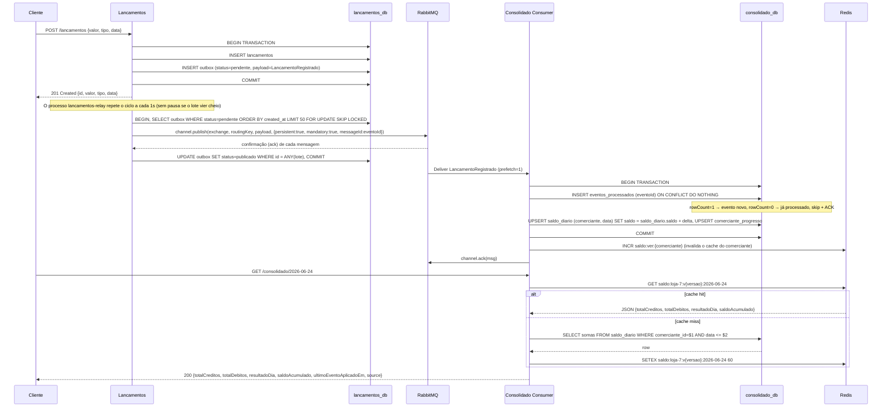
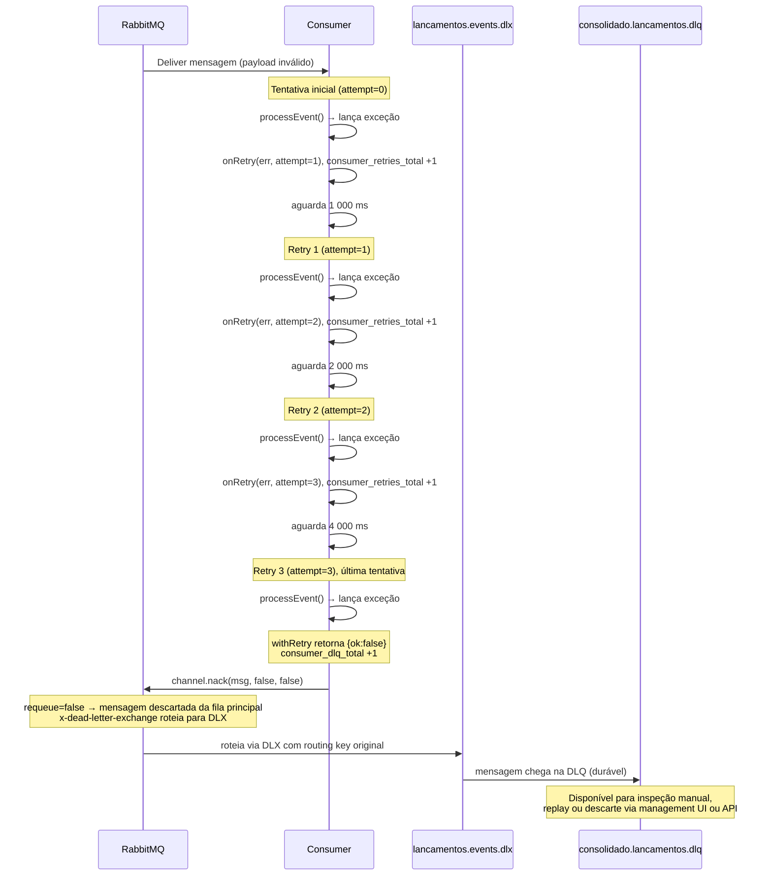

# Arquitetura do Sistema

## C4, nível 1: Contexto

---

## C4, nível 2: Containers

---

## C4, nível 3: Componentes do Serviço Lancamentos

---

## C4, nível 3: Componentes do Serviço Consolidado

---

## Diagrama de Sequência: Fluxo Feliz

---

## Diagrama de Sequência: Fluxo de Falha (Retry + DLQ)

Este diagrama mostra o caminho de uma mensagem válida cujo processamento falha de forma persistente, por exemplo com o banco do consolidado indisponível por mais de 7 segundos (coberto por `dlq.test.ts`). Uma mensagem malformada (JSON inválido ou fora do contrato) é diferente: vai direto para a DLQ, sem retentativas.

**Resumo do comportamento:**
- 4 chamadas a `processEvent` no total (1 inicial + 3 retries)
- 3 incrementos em `consolidado_consumer_retries_total` (um por callback de retry)
- 1 incremento em `consolidado_consumer_dlq_total`
- Tempo mínimo antes do NACK: 1 000 + 2 000 + 4 000 = **7 segundos** (mais tempo de execução das 4 tentativas)

---

## Cenários de falha

O que acontece quando cada peça falha, o que limita o dano e qual teste prova o comportamento. "Lacuna" significa que o comportamento vem do código e da análise, sem teste automatizado dedicado.

| Cenário | Comportamento | Mitigação | O que prova |
|---|---|---|---|
| Consolidado fora do ar | `POST /lancamentos` continua respondendo 201. Os eventos se acumulam na fila `consolidado.lancamentos`. Ao voltar, o consumidor drena e o saldo converge | Processos, bancos e filas separados; broker durável | `tests/resiliencia`, cenário A: 30 de 30 lançamentos aceitos e saldo convergindo na volta |
| Broker (RabbitMQ) fora do ar | Lançamentos segue aceitando (201) e `/ready` da API continua 200, porque a API só depende do banco. O outbox acumula e o relay reconecta com backoff; na volta, drena | Outbox transacional; relay em processo separado; `ConfirmChannel` e `mandatory` | `tests/resiliencia`, cenário B; `relay.test.ts` (sem confirmação e sem rota mantêm o evento pendente); `reconexao.test.ts` (o consumidor retoma sozinho) |
| Redis fora do ar | As leituras do consolidado caem para o banco (`source: "database"`) e a invalidação do cache falha sem derrubar o processamento do evento. **Atenção:** `/ready` do consolidado faz `PING` no Redis e fica 503; com o health check do balanceador em `/ready`, as tarefas seriam retiradas. Na AWS o health check do ALB deve usar `/health` | Cache-aside com fallback; falha de cache tratada como não fatal no código | **Lacuna.** Não há teste de falha do Redis ([testes.md](testes.md)). O ajuste de `/ready` está em [evolucoes.md](evolucoes.md) |
| Banco do consolidado fora do ar | A API de leitura responde 5xx. O consumidor tenta 3 vezes (1 s, 2 s e 4 s) e, esgotadas, manda a mensagem **intacta** para `consolidado.lancamentos.dlq`. Interrupções maiores que cerca de 7 segundos geram mensagens na DLQ que precisam de reprocessamento manual. Lançamentos não é afetado | A idempotência torna o reprocessamento seguro; alerta em `consolidado_consumer_dlq_total`; roteiro em [disaster-recovery.md](disaster-recovery.md) | `dlq.test.ts` (banco indisponível: 3 tentativas e mensagem intacta na DLQ). A ferramenta de reprocessamento da DLQ não existe ([evolucoes.md](evolucoes.md)) |
| Banco de lançamentos fora do ar | `POST /lancamentos` falha e `/ready` da API fica 503. É a única dependência que o RNF não cobre, por isso o RDS é Multi-AZ. O relay não consegue ler o outbox e tenta de novo | RDS Multi-AZ com failover automático | **Lacuna** em teste automatizado; o 5xx e o `/ready` vêm do código |
| Evento duplicado | O mesmo `eventoId` altera o saldo uma única vez. Acontece por reentrega do broker ou por falha depois do ack do broker e antes do `COMMIT` do relay | `eventos_processados` com `ON CONFLICT DO NOTHING` na mesma transação do saldo; várias instâncias do relay usam `SKIP LOCKED` | `idempotencia-cache.test.ts` (entregue duas vezes, soma uma); `relay.test.ts` (várias instâncias publicam cada evento uma vez) |
| Evento fora de ordem | O saldo é uma soma, então a ordem não altera o resultado. Um lançamento retroativo corrige o acumulado das datas seguintes. `ultimoEventoAplicadoEm` guarda o maior instante aplicado | Upsert aditivo; cache versionado por comerciante (a versão avança depois do commit) | `saldo-comerciantes.test.ts` (lançamento retroativo; `ultimoEventoAplicadoEm` com eventos fora de ordem; corrida de gravação atrasada no cache) |
| Evento inválido ou de versão incompatível | Vai direto para a DLQ, sem retentativas e sem alterar o saldo. Evento de outro tipo é reconhecido e ignorado | Contrato versionado ([eventos.md](eventos.md)) | `dlq.test.ts` (evento malformado); `evento-versoes.test.ts` |
| Provedor de identidade (Keycloak) fora | Tokens já emitidos continuam valendo até expirar (até 300 s) porque a chave pública fica em cache. Sem cache e sem JWKS, a API responde 503, não 401 | JWKS em cache; validação local | `seguranca.test.ts` (503 quando o JWKS cai; a chave em cache continua valendo) |
| Pico acima de 50 req/s | Até 6.000 req/min por IP o consolidado atende; acima disso recebe 429 com `Retry-After`, sem 5xx. No pico de 200 req/s medido, uma instância respondeu cerca de 197 a 199 req/s | Cache Redis, rate limit, escala horizontal ([dimensionamento.md](dimensionamento.md)) | `tests/load/consolidado.js` (pico: só 200 e 429, sem 5xx) e `limite-429.js` (429 com `Retry-After`, determinístico). O rate limit é em memória por instância |

---

## Contrato do evento `LancamentoRegistrado`

O contrato completo, o histórico de versões (1.0 e 1.1) e a política de versionamento estão em [eventos.md](eventos.md).
