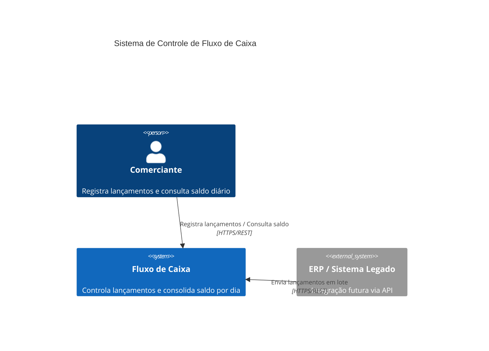
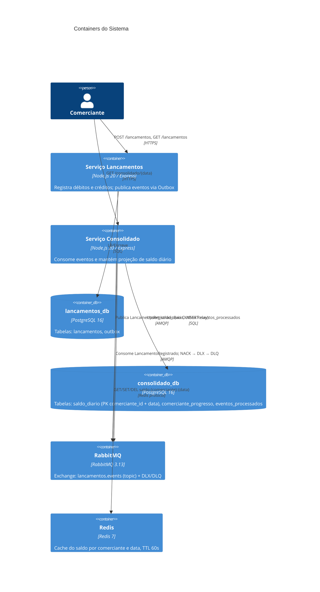
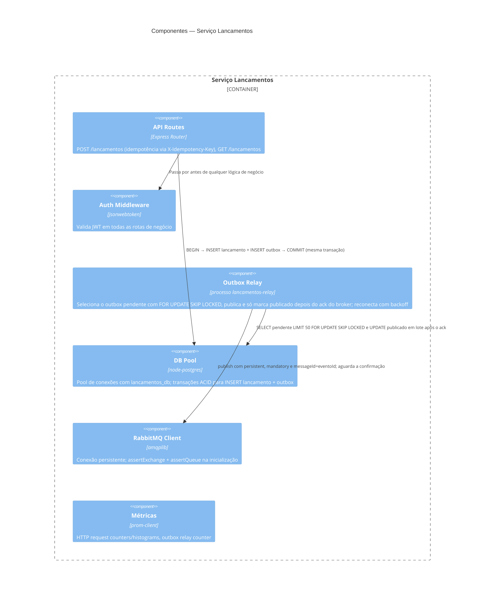
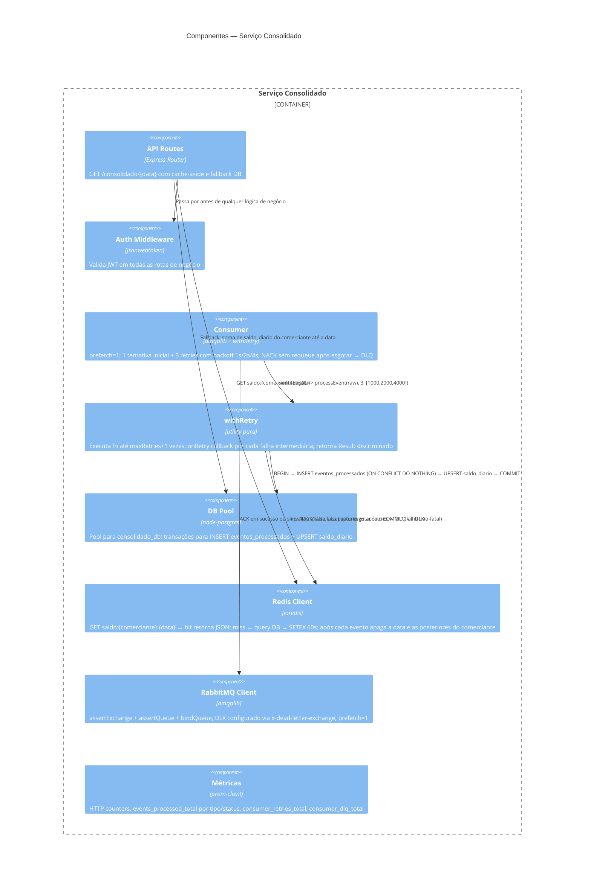

# Arquitetura do Sistema

## C4 — Nível 1: Contexto



---

## C4 — Nível 2: Containers



---

## C4 — Nível 3: Componentes do Serviço Lancamentos



---

## C4 — Nível 3: Componentes do Serviço Consolidado



---

## Diagrama de Sequência — Fluxo Feliz

```mermaid
sequenceDiagram
    participant C as Cliente
    participant L as Lancamentos
    participant DB_L as lancamentos_db
    participant RMQ as RabbitMQ
    participant CONS as Consolidado Consumer
    participant DB_C as consolidado_db
    participant REDIS as Redis

    C->>L: POST /lancamentos {valor, tipo, data}
    L->>DB_L: BEGIN TRANSACTION
    L->>DB_L: INSERT lancamentos
    L->>DB_L: INSERT outbox (status=pendente, payload=LancamentoRegistrado)
    L->>DB_L: COMMIT
    L-->>C: 201 Created {id, valor, tipo, data}

    Note over L: O lancamentos-relay executa a cada 1s

    L->>DB_L: SELECT outbox WHERE status=pendente ORDER BY created_at LIMIT 50
    L->>RMQ: channel.publish(exchange, routingKey, payload, {persistent:true, messageId:eventoId})
    L->>DB_L: UPDATE outbox SET status=publicado WHERE id=$1

    RMQ->>CONS: Deliver LancamentoRegistrado (prefetch=1)
    CONS->>DB_C: BEGIN TRANSACTION
    CONS->>DB_C: INSERT eventos_processados (eventoId) ON CONFLICT DO NOTHING
    Note over DB_C: rowCount=1 → evento novo; rowCount=0 → já processado, skip + ACK
    CONS->>DB_C: UPSERT saldo_diario (comerciante, data) SET saldo = saldo_diario.saldo + delta; UPSERT comerciante_progresso
    CONS->>DB_C: COMMIT
    CONS->>REDIS: invalida saldo:{comerciante}:{data} e as datas posteriores
    CONS->>RMQ: channel.ack(msg)

    C->>CONS: GET /consolidado/2026-06-24
    CONS->>REDIS: GET saldo:loja-7:2026-06-24
    alt cache hit
        REDIS-->>CONS: JSON {totalCreditos, totalDebitos, resultadoDia, saldoAcumulado}
    else cache miss
        CONS->>DB_C: SELECT somas FROM saldo_diario WHERE comerciante_id=$1 AND data <= $2
        DB_C-->>CONS: row
        CONS->>REDIS: SETEX saldo:loja-7:2026-06-24 60
    end
    CONS-->>C: 200 {totalCreditos, totalDebitos, resultadoDia, saldoAcumulado, atualizadoAte, source}
```

---

## Diagrama de Sequência — Fluxo de Falha (Retry + DLQ)

Este diagrama mostra o caminho de uma mensagem que falha em processamento de forma persistente — por exemplo, um payload com valor não-numérico que sempre lança no `new Decimal(valor)`.


**Resumo do comportamento:**
- 4 chamadas a `processEvent` no total (1 inicial + 3 retries)
- 3 incrementos em `consumerRetriesTotal` (um por callback de retry)
- 1 incremento em `consumerDlqTotal`
- Tempo mínimo antes do NACK: 1 000 + 2 000 + 4 000 = **7 segundos** (mais tempo de execução das 4 tentativas)

---

## Contrato do evento `LancamentoRegistrado`

O contrato completo, o histórico de versões (1.0 e 1.1) e a política de versionamento estão em [eventos.md](eventos.md).
