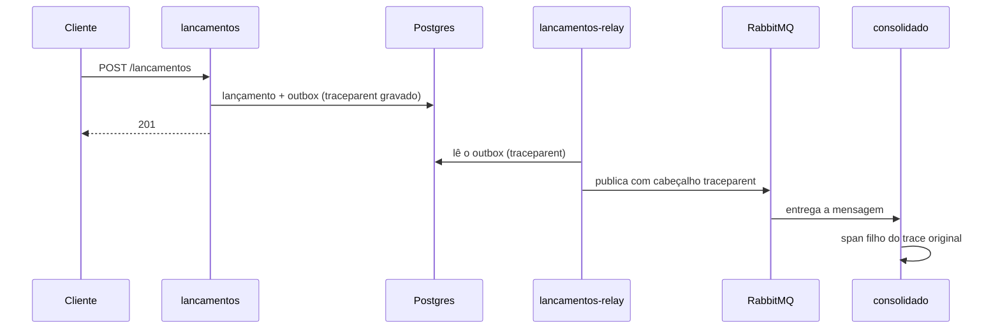

# Observabilidade

## O que está implementado

### Métricas Prometheus: sempre ligadas

Ambos os serviços expõem `/metrics` sem autenticação, prontos para scraping pelo Prometheus.

As métricas HTTP (`*_http_requests_total` e `*_http_request_duration_seconds`) são alimentadas por um middleware (`src/middleware/metricasHttp.ts`). O rótulo `route` é o padrão da rota (por exemplo `/consolidado/:data`), não a URL real, para não criar uma série por data. As respostas que não chegam a uma rota (401, 429, 404) caem no prefixo de montagem ou em `desconhecida`. O `/metrics` não é medido.

**Lançamentos (`:3001/metrics`):**

| Métrica | Tipo | Labels | Descrição |
|---|---|---|---|
| `lancamentos_http_requests_total` | Counter | `method, route, status` | Volume de requisições HTTP |
| `lancamentos_http_request_duration_seconds` | Histogram | `method, route, status` | Latência das requisições; buckets: 5ms a 2.5s |
| `lancamentos_created_total` | Counter | `tipo` (`credito`\|`debito`) | Lançamentos criados por tipo |
| `lancamentos_outbox_events_published_total` | Counter | n/a | Eventos publicados e confirmados pelo broker (processo `lancamentos-relay`) |
| `lancamentos_outbox_publish_failures_total` | Counter | n/a | Lotes do outbox que falharam (sem confirmação, sem rota ou conexão caída) |
| `lancamentos_outbox_pendentes` | Gauge | n/a | Eventos no outbox ainda não publicados (calculado a cada scrape, só no processo do relay) |
| `lancamentos_outbox_idade_mais_antigo_segundos` | Gauge | n/a | Idade do evento pendente mais antigo; 0 quando não há pendentes |
| `lancamentos_rabbitmq_connected` | Gauge | n/a | 1 quando o relay está conectado ao RabbitMQ |
| Métricas Node.js default | n/a | n/a | Heap, GC, CPU, event loop lag |

**Consolidado (`:3002/metrics`):**

| Métrica | Tipo | Labels | Descrição |
|---|---|---|---|
| `consolidado_http_requests_total` | Counter | `method, route, status` | Volume de requisições HTTP |
| `consolidado_http_request_duration_seconds` | Histogram | `method, route, status` | Latência das requisições; buckets: 5ms a 2.5s |
| `consolidado_events_processed_total` | Counter | `tipo, status` | Eventos processados; `status`: `processed`, `skipped`, `dlq`, `invalid` |
| `consolidado_consumer_retries_total` | Counter | n/a | Cada vez que `withRetry` chama o callback `onRetry`; uma mensagem que esgota os retries contribui **3** para este contador (não 4, a última tentativa falha sem callback) |
| `consolidado_consumer_dlq_total` | Counter | n/a | Mensagens enviadas à DLQ após esgotar retries; deve ser próximo de zero em operação normal |
| `consolidado_evento_lag_seconds` | Histogram | n/a | Lag: tempo entre a criação do evento (`createdAt`) e a aplicação ao saldo. Buckets de 50 ms a 300 s |
| `consolidado_rabbitmq_connected` | Gauge | n/a | 1 quando o consumidor está conectado ao RabbitMQ |
| Métricas Node.js default | n/a | n/a | Heap, GC, CPU, event loop lag |

> **Interpretação de `consumer_retries_total`:** O valor N neste counter não significa N execuções de `processEvent` que falharam, significa N callbacks de retry chamados. Uma mensagem que falha 4 vezes (1 inicial + 3 retries) contribui com 3 para `consumer_retries_total` e 1 para `consumer_dlq_total`. Para saber o total de tentativas, some `consumer_retries_total + consumer_dlq_total` (onde cada entry na DLQ representa 1 tentativa não contada no retries counter).

### Logs Estruturados (pino)

Todos os logs são JSON estruturado com nível (`info`, `warn`, `error`, `debug`). O `correlationId` é gerado no `POST /lancamentos` (do header `X-Correlation-Id` ou gerado automaticamente) e propagado no payload do evento, aparecendo nos logs do consumer:

```json
// Log do lancamentos:
{"level":"info","correlationId":"7f3e9c1a","eventoId":"550e8400","lancamentoId":"a1b2c3d4","msg":"Lancamento registered"}

// Log do consolidado (mesmo correlationId):
{"level":"info","correlationId":"7f3e9c1a","eventoId":"550e8400","data":"2024-01-15","tipo":"credito","valor":"1500.00","msg":"Event processed"}
```

Quando o tracing está ligado, cada linha de log dentro de uma requisição ou de um processamento de evento também traz `traceId` e `spanId`, o que permite pular do log para o trace no Jaeger e vice-versa.

Rastrear um lançamento de ponta a ponta pelo `correlationId`:
```bash
docker compose logs lancamentos | grep "7f3e9c1a"
docker compose logs consolidado | grep "7f3e9c1a"
```

### Health Checks

| Endpoint | Tipo | Verifica |
|---|---|---|
| `GET /health` | Liveness | Processo vivo; retorna `{"status":"ok"}` incondicionalmente |
| `GET /ready`, lancamentos | Readiness | `SELECT 1` no banco. A API não depende do broker, que é assunto do `lancamentos-relay` |
| `GET /ready`, consolidado | Readiness | `SELECT 1` no banco + `PING` no Redis + canal RabbitMQ |

O Docker Compose usa `/ready` como healthcheck de `lancamentos`, `lancamentos-relay` e `consolidado`, e `docker compose up --wait` só retorna quando os três estão saudáveis. O `/ready` do consolidado e do relay fica 503 quando a conexão com o RabbitMQ cai; o da API de lançamentos depende apenas do banco.

### Graceful Shutdown

Ao receber SIGTERM, o consumer do Consolidado:

1. Cancela o consumer tag via `channel.cancel(consumerTag)`, o broker para de enviar novas mensagens
2. Seta `shuttingDown = true`, mensagens recebidas durante o shutdown são requeued (não perdidas)
3. Aguarda até 8s para a mensagem em processamento (`inFlight > 0`) terminar
4. Fecha o canal e a conexão AMQP

Isso garante que métricas Prometheus e logs de conclusão do evento em processamento são emitidos antes do processo encerrar.

### Prometheus + Grafana (profile opcional)

```bash
docker compose --profile observability up -d
# Prometheus: http://localhost:9090
# Grafana:    http://localhost:3000  (admin/admin)
```

O dashboard **"Fluxo de Caixa: Overview"** é provisionado automaticamente via
`observability/grafana/provisioning/dashboards/caixa-flow.json`. Painéis:

- Taxa de requisições e latência p50/p95 do Lançamentos
- Taxa de eventos processados por status (`processed`/`skipped`/`dlq`/`invalid`) do Consolidado
- Contadores de retries e DLQ do consumer (com thresholds coloridos)
- Heap Node.js de ambos os serviços
- Lag do consolidado (p50, p95 e p99), eventos pendentes no outbox e idade do mais antigo
- Taxa de requisições do consolidado por status e respostas de proteção (401, 403, 413 e 429)

---

## Tracing distribuído (OpenTelemetry)

Os dois serviços e o relay exportam traces por OTLP/HTTP. No profile `observability` o Jaeger recebe os spans em memória e a interface fica em http://localhost:16686.



Como funciona:

- **Ligar e desligar:** o SDK só inicia quando `OTEL_EXPORTER_OTLP_ENDPOINT` está definido. O compose **não** define por padrão, então o tracing vem desligado e o código de tracing vira no-op. Para ligar com o Jaeger: `docker compose -f docker-compose.yml -f docker-compose.tracing.yml --profile observability up -d --wait`. Com o endpoint definido e sem o Jaeger no ar, os spans são descartados.
- **Custo:** o tracing acrescenta CPU por requisição. Em medições a 50 req/s o consolidado ficou entre 29% e 65% de CPU com o tracing ligado e o Jaeger no ar, contra cerca de 30% desligado, e em janelas ruins chegou a 145% (`evidencias/regressao-latencia.txt`). Por isso ele vem desligado por padrão. `OTEL_INSTRUMENTACOES` (lista separada por vírgula, padrão `http,express,pg`) permite reduzir os spans.
- **Instrumentação automática:** HTTP, Express (rotas e handlers) e `pg`. Os endpoints `/health`, `/ready` e `/metrics` não geram spans.
- **Propagação pelo RabbitMQ:** a instrumentação automática não cobre o salto assíncrono do Outbox, então a propagação é explícita. A requisição grava o `traceparent` (W3C) em `outbox.traceparent`. O relay, que roda depois e em outro processo, cria o span `outbox publicar` como filho desse contexto e publica a mensagem com o cabeçalho `traceparent`. O consolidado lê o cabeçalho e cria o span `consolidado.lancamentos processar` no mesmo trace.
- **Eventos antigos:** linhas do outbox gravadas antes da migration 004 não têm `traceparent`; o relay inicia um trace novo para elas.
- **Amostragem:** todos os traces são coletados (padrão do SDK). Em produção, usar `OTEL_TRACES_SAMPLER=parentbased_traceidratio` com `OTEL_TRACES_SAMPLER_ARG` para limitar o volume.

Exemplo real de um `POST /lancamentos` atravessando os três processos, coletado do Jaeger: [evidencias/trace-ponta-a-ponta.txt](evidencias/trace-ponta-a-ponta.txt).

Para ver na interface:

```powershell
docker compose --profile observability up -d --wait
.\scripts\seed-demo.ps1
# Abra http://localhost:16686, escolha o serviço "lancamentos" e clique em Find Traces
```

---

## SLOs Sugeridos para Produção

| Indicador | Objetivo | Alerta |
|---|---|---|
| Disponibilidade `POST /lancamentos` | > 99.9% em 30 dias | < 99.5% em janela de 1h |
| Latência `POST /lancamentos` p99 | < 200ms | > 500ms por 5min |
| Taxa de erro `POST /lancamentos` | < 0.1% | > 1% por 5min |
| Disponibilidade `GET /consolidado` | > 99.5% em 30 dias | < 99% em janela de 1h |
| Latência `GET /consolidado` p95 | < 100ms (cache quente) / < 200ms (cache frio) | > 200ms por 5min |
| Taxa de mensagens na DLQ | < 0.01% do total | Qualquer mensagem na DLQ → alerta imediato |
| Lag de consistência (lançamento → saldo) | < 5s em p99 | > 30s → investigar relay ou broker |

Alertas baseados em `consolidado_consumer_dlq_total` e `consolidado_consumer_retries_total` são especialmente importantes: um spike de retries indica problema transiente (ex: banco sobrecarregado); mensagens na DLQ indicam problema persistente (ex: payload inválido ou bug no processamento) que requer intervenção manual.
