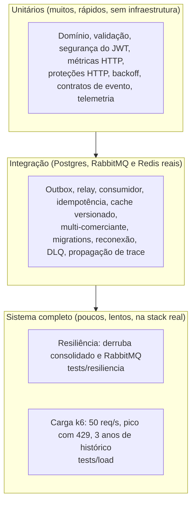

# Estratégia de testes

Este documento mostra o que cada camada de teste prova, como rodar e a quais requisitos não funcionais (RNF, em [requisitos.md](requisitos.md)) ela dá evidência. Onde há uma saída real salva, ela está em [evidencias/](evidencias/).

## Pirâmide

| Camada | Onde | Infraestrutura | Tempo típico | Como rodar |
|---|---|---|---|---|
| Unitário | `services/*/tests/unit` | Nenhuma (um IdP de teste local publica o JWKS) | cerca de 20 s por serviço | `docker compose run --rm lancamentos npm test` ou `npm run test:unit` dentro do serviço |
| Integração | `services/*/tests/integration` | `docker-compose.integration.yml` (Postgres 5433, RabbitMQ 5673, Redis 6380) | cerca de 1 min no total | `.\test-integration.ps1` ou `bash test-integration.sh` |
| Resiliência | `tests/resiliencia` | A stack principal no ar | cerca de 2 min | `.\tests\resiliencia\resiliencia.ps1` ou `bash tests/resiliencia/resiliencia.sh` |
| Carga | `tests/load` | A stack principal no ar, com Keycloak | cerca de 3 min por cenário | `docker compose --profile loadtest run --rm k6` |
| Custo do JWT | `services/consolidado/tests/benchmark` | Nenhuma | cerca de 1 min | `npm run bench:auth` dentro do serviço |

A integração contínua (`.github/workflows/ci.yml`) roda lint, verificação de tipos, testes unitários, testes de integração, build das duas imagens e validação do compose. Resiliência e carga ficam fora do CI porque dependem da stack inteira e de tempo; são executadas sob demanda.

## O que cada camada prova, por requisito

| RNF | O que exige | Evidência | Camada |
|---|---|---|---|
| RNF-01 Disponibilidade independente | Lançamentos responde 2xx com o consolidado fora do ar | 30 de 30 lançamentos aceitos com o consolidado parado, e o saldo converge quando ele volta ([resiliência](evidencias/)) | Resiliência |
| RNF-01 (variante) | Lançamentos continua aceitando com o RabbitMQ fora | 30 de 30 aceitos com o broker parado, `/ready` da API segue 200, o outbox acumula e drena na volta | Resiliência |
| RNF-02 Throughput e RNF-03 Perda | 50 req/s no consolidado com menos de 5% de perda | k6: `non_ok_rate` em 0,00% nos cenários de cache quente e frio, nas 5 execuções registradas ([saídas](evidencias/)) | Carga |
| RNF-03 (acima da cota) | O excedente é recusado de forma controlada | k6, cenário de pico a 200 req/s: 2502, 2001 e 2502 respostas 429, todas com `Retry-After`, nenhum 5xx (3 execuções) | Carga |
| RNF-04 Latência | p95 abaixo de 500 ms | k6 completo, 3 execuções seguidas após a correção: p95 de 9,3 a 9,7 ms (`cache_hit`) e de 8,9 a 9,6 ms (`cache_miss`), código de saída 0 ([saídas](evidencias/)). Antes da correção, 1 execução passou e 1 falhou (p95 de 1,35 e 2,82 s) | Carga |
| RNF-05 Consistência eventual | Saldo converge em segundos e nunca serve valor anterior ao evento aplicado | Integração: cache versionado, incluindo a corrida de gravação atrasada; resiliência: tempo de convergência medido; métrica `consolidado_evento_lag_seconds` | Integração, resiliência |
| RNF-06 Sem perda de eventos | Evento só é marcado publicado após o broker confirmar | Integração do relay: sem confirmação (nack) e sem rota mantêm o evento pendente; várias instâncias publicam cada evento uma vez | Integração |
| RNF-07 Idempotência | Reentrega não duplica saldo | Integração: o mesmo evento aplicado duas vezes soma uma; chave de idempotência por comerciante e 409 com corpo diferente | Integração |
| RNF-08 Segurança | Token válido, escopo e comerciante | Unitário: assinatura, `alg`, issuer, audiência, expiração, escopo, comerciante, 503 quando o JWKS cai; 413 para corpo grande; cabeçalhos do helmet | Unitário |
| RNF-09 At-least-once | Resiliente a redelivery | Ver RNF-07; integração de reconexão do broker e da DLQ | Integração |
| RNF-10 Graceful shutdown | Sem perda de mensagem em processamento | Cobertura parcial: o comportamento de nack durante o desligamento está no código do consumidor, sem teste automatizado dedicado | Lacuna conhecida |

## O que cada grupo de testes cobre

**Unitários**

- Validação de entrada (zod): valor como string decimal, tipo, data real do calendário, descrição.
- Segurança do JWT com um IdP de teste: aceita token correto; recusa assinatura alheia, `alg: none`, HS256, issuer, audiência, expiração e ausência de `exp`; 403 por escopo; 503 quando o JWKS está fora; a chave em cache continua valendo.
- API pelo supertest: 400 `problem+json`, 404, 401, 413 e cabeçalhos de segurança.
- Métricas HTTP: o contador e o histograma recebem o padrão da rota (por exemplo `/consolidado/:data`), nunca a URL real.
- Contrato do evento: versões 1.0, 1.1 e 2.x, campos obrigatórios, cálculo de delta.
- Backoff do broker e `withRetry`.
- Telemetria: um span que recebe `traceparent` continua o trace e vira filho do span de origem.

**Integração**

- Registro: atomicidade entre lançamento e outbox, idempotência concorrente, isolamento entre comerciantes.
- Relay: confirmação do broker, mensagem sem rota, várias instâncias concorrentes sem duplicar.
- Consumidor: idempotência, saldo acumulado com lançamento retroativo, dia vazio, intervalo.
- Cache: invalidação por versão e a corrida entre leitor lento e evento novo.
- Migrations: upgrade sobre dados existentes em banco temporário.
- Reconexão: `rabbitmqctl close_all_connections` e retomada do consumo.
- DLQ: evento inválido ou esgotado vai para a fila morta.
- Trace: o `traceparent` gravado no outbox chega ao cabeçalho da mensagem.

**Resiliência** (stack real)

- Cenário A: consolidado parado, `N` lançamentos (padrão 30), todos com 201; os eventos ficam na fila; ao voltar, o saldo é igual a `N x 10.00`.
- Cenário B: RabbitMQ parado, `N` lançamentos, todos com 201; o outbox acumula pelo menos `N` pendentes; ao voltar, o relay drena e o saldo converge.

**Carga** (stack real)

- `consolidado.js`: cache quente, cache frio e pico a 200 req/s acima da cota.
- `historico-longo.js`: 1095 dias de lançamentos de um comerciante e a conferência do acumulado em 1095 datas.

## Limites deste conjunto de testes

- Não há teste de falha do Redis nem de lentidão do Postgres. O cache é tratado como opcional no código, mas isso não está provado por teste automatizado.
- Não há teste de carga sobre o lançamentos. O requisito de 50 req/s é do consolidado.
- **Regressão de latência encontrada e tratada.** Depois da fase 4, o k6 completo passou a falhar (p95 de segundos). Não consegui provar uma causa única: o bisect não achou um commit estável e a degradação também apareceu com o tracing desligado. Foram corrigidos os custos comprovados (tracing desligado por padrão no compose, healthcheck do RabbitMQ por porta) e três execuções seguidas passaram. Investigação completa em `evidencias/regressao-latencia.txt`.
- Os números de carga são de uma máquina de desenvolvimento com Docker Desktop, com todos os serviços e o Keycloak disputando o mesmo hardware. Servem para comparar cenários entre si, e não como capacidade de produção.
- O CI foi escrito e validado só quanto à sintaxe do YAML. Ele ainda não rodou no GitHub.
